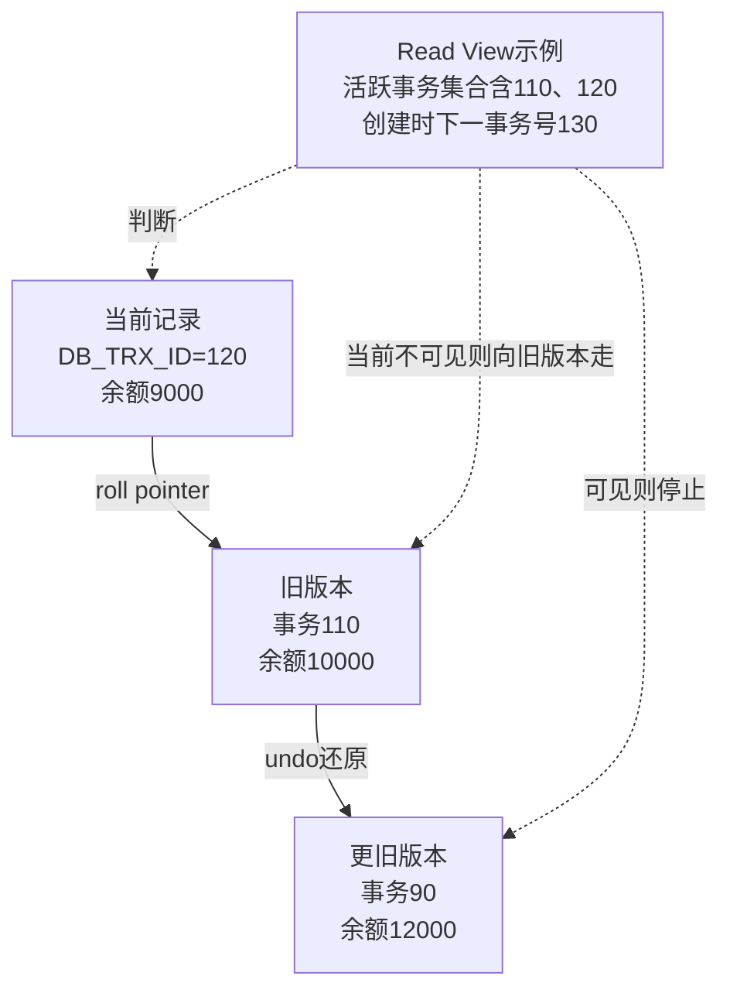
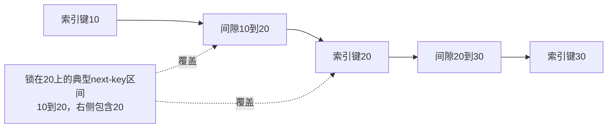

# MySQL MVCC、锁冲突、执行计划与恢复实验

> 基线：MySQL 8.0/8.4、InnoDB。原有 [MySQL.md](MySQL.md) 已覆盖架构、索引和锁分类，本文补上可观察的并发时序、计划分析和生产恢复。所有建表与写操作只在独立练习库执行。

**阅读主线**：read view与版本链 → 锁区间 → 双会话实验 → 计划与恢复。

**快速入口**：[面试题与参考答案](#reference-answers)。

## 阅读目录

- [1. 数据库正确性从不变量开始](#section-1)
- [2. Read View 与版本链](#section-2)
- [3. 准备实验数据](#section-3)
- [4. 实验一：RR 一致性读与锁定读](#section-4)
- [5. 实验二：丢失更新与原子扣减](#section-5)
- [6. Record、Gap、Next-Key Lock 的适用边界](#section-6)
- [7. 实验三：死锁与整体事务重试](#section-7)
- [8. 索引设计：从查询族而非单条 SQL 出发](#section-8)
- [9. 执行计划：估计与实际分开](#section-9)
- [10. 分页、批量与大事务](#section-10)
- [11. 主从复制与读写分离](#section-11)
- [12. Expand-Contract 数据迁移](#section-12)
- [13. 慢接口诊断案例](#section-13)
- [14. 面试题与参考答案](#section-14)
- [15. 官方资料](#section-15)

<a id="section-1"></a>

## 1. 数据库正确性从不变量开始

库存不能为负、同一业务请求只能创建一个订单、转账前后总金额守恒，这些约束需要由事务、原子写入和唯一性共同维护。把全部并发问题归结为隔离级别，往往会忽略应用先读后写和外部副作用。

先确定事实表、唯一键、合法状态迁移和失败结果，再选择隔离、锁或版本。高隔离并不自动把错误 SQL 变正确，也不意味着所有请求都应串行。

<a id="section-2"></a>

## 2. Read View 与版本链

InnoDB 用 undo 等机制支持旧版本读取。普通一致性读根据 read view 判断哪个版本可见，未必读取当前最新物理记录；更新和锁定读属于另一条访问语义，不能简单等同于普通 SELECT。

### 2.1 RC 和 RR 的关键区别

### 2.2 可见性判断怎样沿 undo 版本链执行

**图 1｜可见性判断怎样沿 undo 版本链执行**



**图解**：图省略真实行格式，undo 不是每一步都完整复制一整行，系统根据所需信息重建版本。事务 ID 表示相关事务身份，不是提交时间戳；事务120提交得更早，也不意味着某个旧 read view 必须看见它。

Read View 的核心包括创建者、创建时活跃读写事务集合和事务 ID 边界。概念化规则如下，变量名用于教学，不对应内部成员的直译：

```text
visible(version_trx_id):
    如果是当前事务自己的写入，按自身变更规则可见
    如果早于创建视图时的最小活跃事务号，属于足够早的已完成历史
    如果大于等于创建视图时的下一事务号，是视图之后的事务，不可见
    否则检查是否在视图的活跃集合中
        在集合：当时尚未完成，不可见
        不在集合：当时已完成，可见
不可见则沿版本链继续寻找
```

边界、活跃集合和自身写入三个因素缺一不可。RR 复用 read view，因此后面完成的别人的事务不自动进入旧视图；RC 每条一致性读更新视图，所以能读到语句开始前的新提交。事务自身已做的修改又可能与旧快照组合，不能把事务内所有 SELECT 描述成永久不变的一张静态照片。

### 2.3 从区间推导 Next-Key Lock

**图 2｜从区间推导 Next-Key Lock**



**图解**：记录锁保护现存索引项，间隙锁约束相应区间的插入，next-key 把前方间隙和记录组合。具体范围不由这张概念图自动决定，还要看查询条件、隔离级别、唯一性和实际扫描路径。索引精确点查可能缩小锁范围，范围扫描可能覆盖额外边界；必须结合 data_locks 验证。

在常见一致性读中，RC 每次语句建立相应新快照；RR 在事务内通常复用首次一致性读建立的快照。`START TRANSACTION` 本身与 `WITH CONSISTENT SNAPSHOT` 的建立时机不同，不应笼统说“begin 的瞬间总会拍快照”。

长事务使旧版本清理受限，即使它大部分时间不执行 SQL，也可能保留重要读视图。排查 undo/history 相关增长时，要找长期未结束事务及应用连接持有路径。

<a id="section-3"></a>

## 3. 准备实验数据

```sql
CREATE DATABASE learninghub_lab;
USE learninghub_lab;
CREATE TABLE account (
  id BIGINT PRIMARY KEY,
  balance_cent BIGINT NOT NULL,
  version BIGINT NOT NULL DEFAULT 0,
  CHECK (balance_cent >= 0)
) ENGINE=InnoDB;
INSERT INTO account VALUES (1, 10000, 0), (2, 10000, 0);
```

如果练习库已经存在，先检查其中内容，不能直接删除重建。CHECK 的真实执行支持与 MySQL 小版本相关，8.0 早期版本行为不能一概而论；应用仍检查更新结果。

开两个独立会话 A/B，明确每个连接的 autocommit 和隔离级别。不要在 GUI 中两个标签却实际共用一个连接，导致时序无法复现。

<a id="section-4"></a>

## 4. 实验一：RR 一致性读与锁定读

```sql
-- 会话 A
SET SESSION TRANSACTION ISOLATION LEVEL REPEATABLE READ;
START TRANSACTION;
SELECT balance_cent FROM account WHERE id = 1; -- 10000
```

```sql
-- 会话 B
START TRANSACTION;
UPDATE account SET balance_cent = 9000, version = version + 1 WHERE id = 1;
COMMIT;
```

```sql
-- 回到会话 A
SELECT balance_cent FROM account WHERE id = 1; -- 仍按旧快照读 10000
SELECT balance_cent FROM account WHERE id = 1 FOR UPDATE; -- 锁定读可见 9000
ROLLBACK;
```

同一个事务中出现两种结果，不是数据库随机不一致，而是两种读取语义不同。因此不能先用快照值计算，再假设后续 UPDATE 一定基于相同旧状态执行。

改成 RC 重复实验，普通第二次查询的结果会不同。记录隔离级别、提交顺序和实际结果，不只背“不可重复读”的定义。

<a id="section-5"></a>

## 5. 实验二：丢失更新与原子扣减

错误流程是两个请求分别读取同一余额，应用各减 1,000，再都 SET balance=9000。数据库可以正确执行每条 SQL，但业务仍丢失一次扣减。

```sql
UPDATE account
SET balance_cent = balance_cent - 1000,
    version = version + 1
WHERE id = 1 AND balance_cent >= 1000;
```

检查受影响行数。这个写法把余额条件和扣减放进一次原子操作，但它不能区分“同一请求重试两次”与“两次合法扣款”，还需业务唯一请求表或流水唯一键。

### 5.1 乐观版本

```sql
UPDATE account
SET balance_cent = :new_balance, version = version + 1
WHERE id = :id AND version = :expected_version;
```

影响 0 行表示条件不满足，不一定就是冲突，也可能记录不存在。重试必须重新读取并重做业务判断，使用退避及次数限制。热点账户大量冲突时，悲观串行、分区或业务聚合可能比无限乐观重试更好。

<a id="section-6"></a>

## 6. Record、Gap、Next-Key Lock 的适用边界

Record lock 约束索引记录，gap lock 约束区间插入，next-key 组合记录及前方间隙。具体锁范围依赖索引、谓词、隔离级别及执行计划，不能只看 WHERE 字面推断。

唯一索引精确命中与范围查询不同，未命中唯一点查又可能涉及插入区间。二级索引及回表会引入更多锁，业务以为“只改一条”并不保证数据库只检查或锁定一条。

### 6.1 观察锁而非凭感觉

在独立练习环境通过 performance_schema.data_locks、data_lock_waits 等查看实际锁和等待，配合事务表及线程映射。工具可见性与权限受版本影响，不要求生产为每个业务账号开放所有诊断权限。

“没索引就锁表”是常见但不精确的简化：InnoDB 的锁机制、扫描访问和锁定记录范围需要分开说。无合适索引可能扫描并锁住大量记录，表现近似阻塞全表业务，但不能替代真实锁类型分析。

<a id="section-7"></a>

## 7. 实验三：死锁与整体事务重试

```sql
-- A
START TRANSACTION;
UPDATE account SET balance_cent = balance_cent - 100 WHERE id = 1;
-- B
START TRANSACTION;
UPDATE account SET balance_cent = balance_cent - 100 WHERE id = 2;
-- A：此语句可能等待 B
UPDATE account SET balance_cent = balance_cent + 100 WHERE id = 2;
-- B：构成循环等待
UPDATE account SET balance_cent = balance_cent + 100 WHERE id = 1;
```

哪个事务被回滚由数据库根据实际情况选择，不把受害者写死。结束剩余会话事务并核对总金额；应用捕获明确死锁错误后，按业务幂等重试整个事务，而不是只补跑最后一句。

### 7.1 预防与取舍

按稳定账户顺序加锁、缩短事务、减少无关更新和创建合适索引能降低死锁。不能承诺彻底消灭，因为其他访问路径也会参与；正确处理死锁仍是正常并发程序的一部分。

锁等待超时和死锁回滚的范围/状态需要按配置及驱动处理，事务失败后不应盲目继续使用同一业务流程。

<a id="section-8"></a>

## 8. 索引设计：从查询族而非单条 SQL 出发

订单查询按 tenant、status、created_at 排序。候选索引可以按等值条件、范围/排序和返回字段分析，但不同筛选组合的选择性不同，一个大联合索引不一定覆盖所有高频查询。

索引也增加写入、存储及 buffer pool 压力。覆盖索引减少部分回表，索引条件下推减少部分无用回表，二者不是相同能力；SELECT * 可能破坏覆盖并增加网络与映射开销。

### 8.1 最左前缀不是绝对口号

按复合排序理解索引是基础，但优化器可能选择范围、全索引扫描、跳跃扫描等不同路径。是否高效需要看实际访问和扫描量，不能只说“用了索引所以没问题”。

<a id="section-9"></a>

## 9. 执行计划：估计与实际分开

EXPLAIN 提供访问路径及估计，EXPLAIN ANALYZE 会真正执行并提供实际节点数据。未知成本的生产查询不应为排障随意执行 ANALYZE；在受控副本或样本先验证。

关注连接顺序、访问方法、预计/实际行数、循环次数、回表、排序和过滤。如果某节点每次只慢 0.1ms 但循环 100 万次，总成本仍巨大；不能只找单个最大耗时数值。

### 9.1 常见误判

- filesort 不保证写磁盘，它表示不能直接按所需索引顺序产出。
- type=ALL 不总是错误，小表或取大部分行时可能合理。
- 索引选择性不是越高越应放第一列，需结合查询约束和排序。
- 索引不可见/直方图等能力有用途但要按版本评估，不能当成自动万能调优。

<a id="section-10"></a>

## 10. 分页、批量与大事务

深 offset 的扫描跳过成本随位置增长，延迟关联减少某些回表但仍可能要扫描大量索引项；游标分页更适合连续遍历。稳定排序带唯一 tie-breaker，并考虑排序字段更新导致的跳动。

批量更新按检查点分段提交可以降低锁与回滚成本，但承认部分成功。若要求全量原子切换，可以用暂存表/版本指针等设计，不直接把 1 亿行更新塞进在线事务。

每批 500 或 1,000 只是起点，不是法则。看 SQL 包大小、redo/binlog、复制延迟、锁等待和恢复代价调整。

<a id="section-11"></a>

## 11. 主从复制与读写分离

写主读从存在延迟，支付完成后立即从副本读可能看到待支付。解决可以是关键路径读主、会话一致性标记或可验证的位点等待，各有延迟与实现成本。

半同步等复制模式提高特定确认条件的数据安全性，不等于任意副本立即可读，也不自动满足所有故障下的零丢失。切换时记录复制位置、分叉风险和客户端路由窗口。

副本不等于备份，误删会复制。备份需要独立保留并验证时间点恢复链路，全量文件和 binlog 的衔接必须可用。

<a id="section-12"></a>

## 12. Expand-Contract 数据迁移

先增加兼容结构，应用同时兼容新旧字段；分批回填并校验；切换读取；观察完整回滚窗口；最后移除旧结构。每一步都要考虑滚动发布时新旧应用共存。

DDL 是否在线、是否锁表及复制影响与版本、表结构和操作类型有关。不能因为用了某个 ALGORITHM 提示就承诺零影响，先在接近规模数据验证并监测元数据锁。

<a id="section-13"></a>

## 13. 慢接口诊断案例

**现象**：接口从 50ms 变成 3s，SQL 本身偶尔只执行 10ms。

**调查**：应用总时间包括连接池等待，池满由几个长事务造成；长事务内还同步调用第三方接口。部分 SQL plan 没变化，所以只盯执行计划找不到根因。

**修复**：拆分外部副作用、缩短持锁边界、限制故障入口并统一重试预算；随后才对高频扫描做索引优化。验证包含故障下的连接池等待和恢复速度，不只是正常状态 SQL 耗时。

<a id="reference-answers"></a>

<a id="section-14"></a>

## 14. 面试题与参考答案

### Q1：RC 和 RR 的 Read View 有什么差别？

**参考答案**：对常见一致性读，RC 每条语句建立相应新视图，RR 通常复用事务内首次一致性读建立的视图，显式一致快照还影响建立时机。可见性由事务身份边界、创建时活跃集合和自身写入决定，版本不可见就沿 undo 找旧版本。锁定读与写不等于普通快照读，所以不能用 RR 一句口诀预测全部 SQL。

### Q2：已经开事务，为什么还会超卖或丢失更新？

**参考答案**：事务不代表所有并发自动串行，应用“先读剩余量，再写绝对值”可能依据相同旧值完成多次写。应把条件和扣减放到原子 UPDATE 中，检查影响行数，多记录时稳定锁顺序并维护整体事务。请求重试仍可能再次扣减，因此还需业务幂等键或唯一流水。隔离、原子操作和请求去重分别解决不同问题。

### Q3：死锁该重试哪部分？

**参考答案**：按数据库明确的事务失败语义，通常重做整个业务事务，重新读取并判断，不能只重跑最后一句，因为此前锁和业务前提可能已失效。重试有限、带退避并保持幂等；同时用稳定锁顺序、合适索引和短事务降低发生概率。记录死锁图、事务 SQL 和调用身份，避免把正常并发错误无限重试成过载。

### Q4：怎样证明一个索引优化值得上线？

**参考答案**：针对真实高频查询族比较访问路径、实际扫描/返回比、循环次数和 P95/P99，固定数据分布和预热条件；同时测写延迟、索引空间和 buffer pool 成本。EXPLAIN 的估计不等于实际执行，filesort 也不必然落盘。上线关注 DDL、元数据锁及复制延迟，并保留回退方案，不能以“计划里出现了索引名”作为唯一证据。

<a id="section-15"></a>

## 15. 官方资料

- [隔离级别](https://dev.mysql.com/doc/refman/8.4/en/innodb-transaction-isolation-levels.html)
- [InnoDB 锁](https://dev.mysql.com/doc/refman/8.4/en/innodb-locking.html)
- [死锁处理](https://dev.mysql.com/doc/refman/8.4/en/innodb-deadlocks-handling.html)
- [EXPLAIN](https://dev.mysql.com/doc/refman/8.4/en/explain.html)
