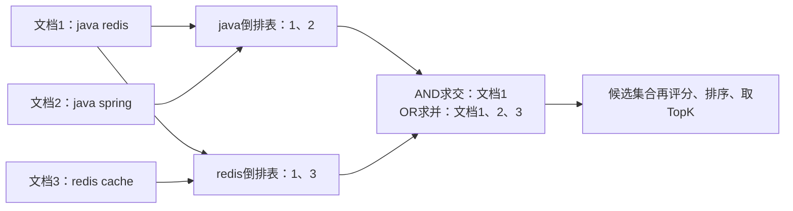
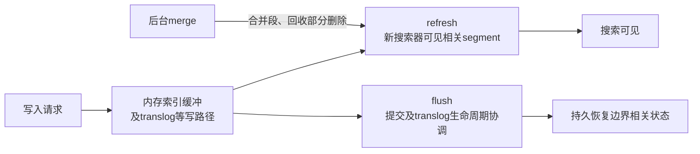

# Elasticsearch 索引原理、查询优化与数据同步深入解析

> 基线：Elasticsearch 8.19，示例使用隔离练习索引。搜索引擎通常是派生读模型，业务事实仍由数据库保存；不要把搜索写入成功当作整个业务事务成功。

**阅读主线**：倒排与评分 → 搜索可见性 → 分片查询 → 同步与重建。

**快速入口**：[面试题与参考答案](#reference-answers)。

## 阅读目录

- [1. 搜索与关系数据库的不同目标](#section-1)
- [2. 倒排索引、分析器与字段](#section-2)
- [3. Segment、refresh、flush 与 merge](#section-3)
- [4. 分片与副本：容量和扇出的交换](#section-4)
- [5. 一个订单索引的显式建模](#section-5)
- [6. Query DSL：过滤与相关性分开](#section-6)
- [7. 深分页与导出](#section-7)
- [8. 数据同步：重复、乱序和删除](#section-8)
- [9. 零停机重建与别名切换](#section-9)
- [10. 慢查询与集群故障](#section-10)
- [11. 面试题与参考答案](#section-11)
- [12. 官方资料](#section-12)

<a id="section-1"></a>

## 1. 搜索与关系数据库的不同目标

关系库擅长事务、约束和结构化查询，全文搜索需要分词、相关性、召回、排序及多维聚合。LIKE '%词%' 不等于全文搜索；而搜索引擎也不自然提供跨文档事务及关系约束。

引入 Elasticsearch 会增加同步延迟、索引重建、容量和运维成本。若只是几十万行的精确 ID 查询，数据库索引可能更简单；若需要中文召回、相关性和高维过滤，搜索模型才更有价值。

<a id="section-2"></a>

## 2. 倒排索引、分析器与字段

倒排索引将词项映射到包含它的文档集合及相关统计信息。查询时先找到候选集合，再根据过滤和评分返回结果；不是逐文档做字符串包含判断。

### 2.1 Analyzer 是一条处理链

字符过滤、分词和 token 过滤共同决定词项。索引时与查询时使用的分析器可能不同，必须考虑同义词、大小写、词干和中文词典。改变索引期分析方式往往需要重建既有数据，不能只改查询就恢复原先没写入的词项。

```json
POST _analyze
{
  "analyzer": "standard",
  "text": "Order search API version 2"
}
```

先用 _analyze 验证实际 token，再解释 match/term 为什么返回不同结果。中文插件需要固定兼容版本和词典发布流程，不能把某个非内置插件当作所有集群必备能力。

### 2.2 text、keyword 和 doc values

text 适合分析后的全文检索，keyword 适合精确值、排序和聚合。多字段可以同时提供两种表示，但增加索引体积。doc values 用列式访问支持部分排序/聚合；不要为方便直接对大 text 字段开启昂贵 fielddata。

### 2.3 object 与 nested

### 2.4 从倒排表推导布尔查询和评分

**图 1｜从倒排表推导布尔查询和评分**



**图解**：查询先围绕词项获取候选，不是拿每个文档做全字符串扫描。真实 postings 还可携带频率、位置等信息，短语查询要检查位置关系；filter 排除候选与 must 相关性评分是不同职责。

BM25 可以概念化为对查询词项累加 `IDF × 词频饱和项 × 文档长度归一化影响`。词出现次数增加通常有收益递减，罕见词与常见词贡献不同，长文档也不能仅凭包含更多词无限占优。具体公式、统计和相似度配置以 Lucene/索引设置为准，调参必须基于标注集，而非把某个 k1/b 值称作行业通用最优。

| 结构 | 访问方向 | 更适合的操作 |
| --- | --- | --- |
| 倒排 | 词项到文档 | 找出包含某词的候选 |
| doc values | 文档到字段值的列式访问 | 排序、部分聚合和脚本读取 |
| _source | 文档的原始 JSON 表示 | 返回内容和重建等场景 |

这也解释了为什么 keyword 常适合聚合，而 text 不应随意开启昂贵 fielddata：为分词文本构造按文档访问词项的结构，会增加堆和管理成本，且未必符合业务聚合语义。

普通对象数组的字段可能按扁平方式表达，查询两个字段时未必保证它们来自同一个数组元素。需要保留元素内关联时用 nested，代价是额外文档、查询与聚合复杂度；不是所有 JSON 对象都要 nested。

<a id="section-3"></a>

## 3. Segment、refresh、flush 与 merge

Lucene segment 基本不可变，更新通常体现为旧文档标记删除与新版本写入。merge 合并段并回收部分删除数据，消耗 I/O 和 CPU；高更新和频繁刷新会影响段数量与合并压力。

refresh 让新写入可被搜索，flush 与提交/translog 生命周期相关，fsync 又是更底层持久化概念。这几个词不能互换，写入响应成功不意味着任意搜索立即命中。

### 3.1 refresh=wait_for 的取舍

**图 2｜refresh=wait_for 的取舍**



**图解**：图展示职责，不将并行工作画成唯一严格时序。搜索可见、稳定存储和段整理回答不同问题。频繁 refresh 可能产生较多小段，merge 又消耗资源；每条写都强制刷新，会把交易交互需求传导成搜索写入压力。

对某些“刚保存就搜索”交互，可等待刷新满足搜索可见性；但不是所有写都需要。每次强制 refresh 会破坏批量和段合并效率。业务可直接返回刚写对象，或对关键页面读取事实源，避免用搜索可见性承担交易确认职责。

<a id="section-4"></a>

## 4. 分片与副本：容量和扇出的交换

每个主分片承担一部分数据，副本提供冗余及读承载。分片过多导致查询扇出、segment、堆和集群元数据压力；分片过大导致恢复慢、迁移粗和热点问题。

分片数要结合数据增长、平均/高分位文档大小、查询并行度和恢复目标。没有适用于所有索引的“每分片固定多少 GB”硬规则；经验区间只能作为压测起点。

### 4.1 查询的两个阶段

查询阶段各分片选出候选结果，协调节点合并排序；获取阶段拉取实际文档内容。深分页时各分片可能保留大量候选，因此 from+size 越大成本越高，不是客户端只拿十条就只做十条工作。

<a id="section-5"></a>

## 5. 一个订单索引的显式建模

```json
PUT orders_lab_v1
{
  "settings": {"number_of_shards": 1, "number_of_replicas": 0},
  "mappings": {
    "dynamic": "strict",
    "properties": {
      "tenant_id": {"type": "keyword"},
      "order_id": {"type": "keyword"},
      "status": {"type": "keyword"},
      "title": {"type": "text", "fields": {"raw": {"type": "keyword"}}},
      "amount_cent": {"type": "long"},
      "created_at": {"type": "date"},
      "business_version": {"type": "long"}
    }
  }
}
```

单分片、零副本仅用于本地练习，不是生产建议。dynamic=strict 避免意外字段膨胀，也意味着升级前必须先发布兼容 mapping。金额以分存储仍需币种及范围定义，不能将所有币种都假设两位小数。

<a id="section-6"></a>

## 6. Query DSL：过滤与相关性分开

```json
GET orders_lab_v1/_search
{
  "size": 20,
  "query": {
    "bool": {
      "filter": [
        {"term": {"tenant_id": "t1"}},
        {"term": {"status": "PAID"}}
      ],
      "must": [{"match": {"title": "mechanical keyboard"}}]
    }
  },
  "sort": [{"_score": "desc"}, {"order_id": "asc"}]
}
```

filter 表达不计分约束，must 参与相应评分语义。filter 不意味着每次都一定缓存，缓存还受查询与系统策略影响。tenant_id 由服务端注入，不能允许调用者自由删除；原始任意 DSL 接口很难形成稳定权限边界。

### 6.1 相关性调优不是随意 boost

先定义带标注的查询集，评估召回、精度和排序质量，再调整字段权重、词典、短语或业务特征。只凭一个关键词的前十条结果改变全局 boost，容易改善一个样本却损伤整体。

### 6.2 高基数聚合

terms 聚合在分布式合并和候选选择上有精度/资源取舍。全量枚举大量不同值应评估 composite 等分页方式；提高 size 并不免费，聚合桶数会占用内存并触发保护。

<a id="section-7"></a>

## 7. 深分页与导出

search_after 使用上页排序值继续，必须有稳定且可比较的排序；PIT 固定相应搜索视图以减少并发刷新导致的跳动。PIT 占用资源，需要关闭/控制保活，不能为每个用户永久保留。

在线列表一般不需要随机跳到第 10 万页；产品交互可以基于筛选和游标。导出作为后台任务，控制查询速率、结果大小、权限和过期时间，不占用普通请求连接无限等待。

<a id="section-8"></a>

## 8. 数据同步：重复、乱序和删除

### 8.1 稳定文档身份

使用业务唯一文档 ID，重复事件覆盖同一文档，而不是每次生成新文档。文档 ID 需考虑租户隔离，两个租户相同业务 ID 不能互相覆盖。

### 8.2 防旧事件覆盖

业务事件携带递增版本，消费端仅接受新版本。Elasticsearch 的 `_seq_no`/`_primary_term` 用于索引内部并发控制，外部版本表达业务顺序，二者不能混为一谈；删除和重建还涉及版本保留窗口。

如果删除文档后很久才到一条旧更新，可能把已删除实体复活。使用墓碑、持久业务版本水位或从事实源确认当前状态，保留窗口要覆盖可能重放时间。

### 8.3 同步不只是投递成功

bulk 响应需要逐项检查，HTTP 整体成功不代表每条都成功。暂时失败重试，映射错误进入可处理流程；保留 event_id、文档 ID、版本与错误原因。

<a id="section-9"></a>

## 9. 零停机重建与别名切换

1. 创建 v2 mapping/settings，验证查询和权限。
2. 记录可恢复的增量边界，对事实库做一致的全量回灌。
3. 继续消费增量，并用业务版本避免全量旧值覆盖较新事件。
4. 校验数量、抽样字段、删除和关键查询结果，观察追平延迟。
5. 使用别名原子切换相关读写路由，明确应用是否都使用别名。
6. 保留旧索引并继续适当增量支持回滚，或声明无法无损回退的条件。

“别名可以原子切换”只解决路由元数据切换，不自动解决全量/增量一致性。旧索引已停止更新时，简单切回会返回旧数据。

<a id="section-10"></a>

## 10. 慢查询与集群故障

先按路由、DSL 模板和分位统计定位，再用慢日志及受控 profile 分析。profile 有额外开销，不应给所有生产请求打开。冷热缓存、文档大小、聚合基数和查询 fan-out 都要纳入对照条件。

| 现象 | 证据 | 常见方向 |
| --- | --- | --- |
| 搜索慢、CPU 高 | profile、热点线程 | 复杂脚本、宽泛查询、聚合 |
| 写拒绝 | 线程池/索引压力、bulk 大小 | 限流、批次、磁盘与 merge |
| shard 未分配 | allocation explain、磁盘水位 | 容量/副本/约束问题 |
| heap 压力 | 桶数、fielddata、缓存 | 降基数、改映射、控查询 |
| 同步延迟大 | oldest event、逐项失败 | 下游容量或永久坏数据 |

不要为恢复 green 就直接降低副本或关闭磁盘保护；先记录可用性和数据风险，再做有依据的措施。

<a id="reference-answers"></a>

<a id="section-11"></a>

## 11. 面试题与参考答案

实验包括：相同数据不同映射、刷新可见性、bulk 部分失败、旧版本覆盖、删除后旧更新、全量回灌与增量并行、别名回滚。每项保留输入、时间线和最终事实库/索引对比。

### Q1：数据库有索引，为什么还引入搜索引擎？

**参考答案**：数据库 B+ 树主要服务结构化访问和事务约束，全文需求还需要分词召回、位置、相关性和聚合，倒排结构更适合这些访问。引入搜索会付出同步延迟、重建和运维成本，所以仅做小规模精确 ID 查询未必值得。选型要从查询语义、数据量和维护能力出发，不以“搜索引擎一定更快”作为理由。

### Q2：写入成功却搜不到，应检查什么？

**参考答案**：先确认同步事件实际到达且 bulk 对应项成功，再看 refresh 可见性；随后用文档身份检查内容，核对 analyzer、term/match 语义和租户过滤。写确认不等于搜索可见，refresh 又不等于所有持久化阶段。关键交易确认可读取事实源，而非强制每次搜索写立即刷新。

### Q3：重建索引怎样避免全量旧数据覆盖增量新数据？

**参考答案**：为业务变化提供单调版本，记录可恢复增量边界，全量与增量都按相同文档身份和版本规则写入，旧版本不覆盖新版本。删除也保留足够水位/墓碑避免旧更新复活。追平后校验数量、字段及查询再切别名；别名原子切换只解决路由，不自动解决数据追平和回滚期间旧索引继续更新的问题。

### Q4：为什么分片更多反而可能更慢？

**参考答案**：每次查询需要更大扇出和协调合并，额外分片、segment、堆及元数据增加成本；深分页和聚合会放大。分片太大则恢复和迁移粒度过粗。按数据增长、真实查询并行度、P99 和恢复目标压测，不能只给一个固定 GB 数或用节点总量推断查询收益。

<a id="section-12"></a>

## 12. 官方资料

- [8.19 映射](https://www.elastic.co/guide/en/elasticsearch/reference/8.19/mapping.html)
- [Lucene BM25Similarity：评分机制](https://lucene.apache.org/core/9_12_3/core/org/apache/lucene/search/similarities/BM25Similarity.html)
- [8.19 Index API](https://www.elastic.co/guide/en/elasticsearch/reference/8.19/docs-index_.html)
- [8.19 分页](https://www.elastic.co/guide/en/elasticsearch/reference/8.19/paginate-search-results.html)
- [8.19 别名](https://www.elastic.co/guide/en/elasticsearch/reference/8.19/aliases.html)
