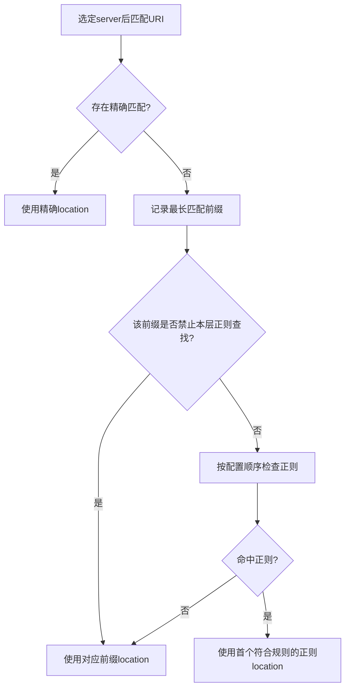
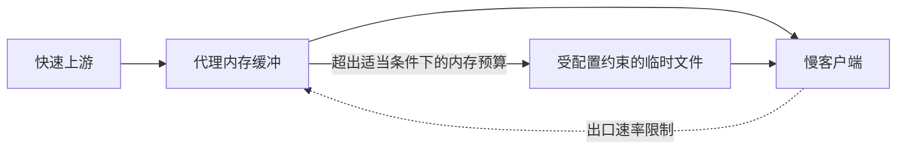

# Nginx 请求路由、代理缓冲与网关治理深入解析

> 基线：开源 Nginx HTTP 代理。健康检查、动态上游解析等功能受版本、模块及商业发行版影响，配置部署前应核对 `nginx -V` 和对应文档。

**阅读主线**：路由匹配 → URI转发 → 缓冲与超时 → 重试和发布。

**快速入口**：[面试题与参考答案](#reference-answers)。

## 阅读目录

- [1. 网关是流量和故障传播边界](#section-1)
- [2. Master/Worker 与连接容量](#section-2)
- [3. server 与 location：匹配规则决定实际路由](#section-3)
- [4. proxy_pass 的 URI 语义](#section-4)
- [5. 连接复用、超时与总 deadline](#section-5)
- [6. 缓冲：把慢客户端与上游部分解耦](#section-6)
- [7. 重试：网关会制造业务重复](#section-7)
- [8. 限流、并发和多副本](#section-8)
- [9. 代理缓存与安全](#section-9)
- [10. 可观测日志设计](#section-10)
- [11. 502、504 与发布问题](#section-11)
- [12. 面试题与参考答案](#section-12)
- [13. 官方资料](#section-13)

<a id="section-1"></a>

## 1. 网关是流量和故障传播边界

网关负责 TLS、路由、转发、限流和部分缓存，但业务授权、幂等及交易正确性不能只交给网关。它既可能保护应用，也可能因重试、错误缓存和无限等待放大故障。

从一次请求路径看，客户端 DNS/TCP/TLS、Nginx 接收、上游连接/等待、应用处理、响应传输各有成本。网关日志需要能分解这些阶段，否则 504 出现后很容易把所有问题都归因“后端慢”。

<a id="section-2"></a>

## 2. Master/Worker 与连接容量

master 负责配置和进程管理，worker 用事件机制处理连接。worker_connections 表示单 worker 连接相关上限，代理请求还占上游连接，不能简单把 worker 数乘连接数当作可承载用户数。

文件描述符、连接内存、TLS 会话、网络带宽、请求体缓冲及上游限额同样约束容量。长连接提高复用也占资源，数万空闲连接与数万活跃上传的成本完全不同。

### 2.1 负载高但 CPU 不高

可能是上游连接等待、磁盘临时文件、网络拥塞或慢客户端。继续增加 worker 并不一定有用，应取连接状态、error log、上游耗时和系统指标。

<a id="section-3"></a>

## 3. server 与 location：匹配规则决定实际路由

先按监听地址/端口及 server_name 等选择 server，未匹配时可能落到默认 server。TLS SNI 与证书选择还有更早阶段，不能仅修改 HTTP Host 就认为所有行为一致。

location 主要区分精确匹配、最长前缀及按规则选择的正则。`^~` 会影响正则查找，正则顺序也可能影响结果。嵌套 location 和内部重定向更复杂，生产配置应减少难以审查的叠加规则。

### 3.1 路由回归表

### 3.2 从匹配决策看“为什么进了另一个 location”

**图 1｜从匹配决策看“为什么进了另一个 location”**



**图解**：这是常见同层 location 的概念流程，嵌套、内部重定向和特定指令还会带来更多分支。前缀并不是简单“谁写在前面谁优先”，而正则次序又确实可能影响结果。URI 规范化和 rewrite 后是否再次匹配，都需要用配置级请求回归验证。

| 请求 | 要明确的行为 |
| --- | --- |
| /api 与 /api/ | 是否重定向、是否进入同一路由 |
| /api/orders?status=PAID | 上游路径与查询参数 |
| /api/static.css | 是否被静态资源正则截走 |
| 编码斜线和重复斜线 | 规范化与上游解释是否一致 |
| 未知 Host | 拒绝还是默认站点 |

安全问题常来自网关和应用对路径解释不同，而不只是某条正则写错。

<a id="section-4"></a>

## 4. proxy_pass 的 URI 语义

```nginx
# A：将 /api/orders 转给上游 /api/orders
location /api/ {
    proxy_pass http://orders_backend;
}
# B：将 /api/orders 按前缀替换为 /orders
location /api/ {
    proxy_pass http://orders_backend/;
}
```

两段是对照示例，不能同时放入同一个 server。是否带 URI、是否有变量、rewrite 和正则 location 都会改变规则，需用真实配置回归，不要只背“末尾加斜线”。

### 4.1 Host 和来源头

Host 取原始客户端值、规范化值还是上游服务名，要按上游虚拟主机/签名需求决定。X-Forwarded-For 等头只能在可信代理边界重建或追加，应用不能把任意来路提交的头当作用户真实 IP。

<a id="section-5"></a>

## 5. 连接复用、超时与总 deadline

```nginx
upstream orders_backend {
    server 127.0.0.1:8080;
    keepalive 32;
}
server {
    listen 8081;
    server_name localhost;
    location /api/ {
        proxy_http_version 1.1;
        proxy_set_header Connection "";
        proxy_set_header Host $host;
        proxy_set_header X-Request-ID $request_id;
        proxy_connect_timeout 2s;
        proxy_send_timeout 5s;
        proxy_read_timeout 10s;
        proxy_pass http://orders_backend;
    }
}
```

本地练习配置未覆盖公网 TLS、认证和所有限额。keepalive 池数量与总活跃连接不是同一上限。连接复用需要 HTTP 版本和 Connection 头等配合，仍要观察上游服务的空闲关闭策略。

connect_timeout 关注建立连接，send/read_timeout 通常关注相应两次操作间隔，不是整个业务请求总耗时。持续缓慢返回可能一直不触发读间隔超时；总 deadline 由应用和入口协作传播。

<a id="section-6"></a>

## 6. 缓冲：把慢客户端与上游部分解耦

**图 2｜缓冲：把慢客户端与上游部分解耦**



**图解**：缓冲吸收上下游速率差，使上游有机会较早完成返回，但空间和磁盘吞吐有限。关闭缓冲会让慢客户端更直接影响上游连接寿命；打开缓冲则要管控内存、临时目录和上传/下载规模。SSE 追求及时送出与批量响应吸收慢客户端压力，是不同目标，不能全站用一个开关解决。

代理响应缓冲可以尽快读取上游结果，再按客户端速度发送，减少上游被慢客户端长时间占用；代价是内存及可能的磁盘临时文件。缓冲不是缓存：前者处理一次传输速度差，后者跨请求复用响应。

### 6.1 SSE 与 WebSocket

SSE 需要事件及时送出，检查应用 flush、代理缓冲及空闲超时。只在前端加 EventSource 不能保证实时显示。关闭缓冲后，上游更直接感受慢客户端，需控制并发和发送速率。

WebSocket 需要正确升级协议，通常用 map 根据 Upgrade 头设置 Connection。升级后连接寿命与普通请求不同，发布和退出时要考虑已有长连接的迁移及最大存活时间。

### 6.2 上传体积与磁盘

请求体可能缓存在内存或临时文件。限 body 大小、防慢上传和临时目录容量，不能只在应用解析完后才判断文件太大。代理请求缓冲策略变化也会影响重试能力与上游资源占用。

<a id="section-7"></a>

## 7. 重试：网关会制造业务重复

上游连接错误或超时时，某些配置允许换节点重试。若上游已经提交订单，只是响应丢失，重试可能创建第二笔订单。HTTP 方法只能提供一般语义，最终需业务幂等键和可查询结果。

### 7.1 重试预算

入口重试 2 次，应用重试 3 次，下游 SDK 重试 3 次，可能把一次请求放大成多次实际操作。统一总预算、有限重试和抖动，明确哪些层负责重试，避免层层“自愈”造成放大。

网关超时向客户端返回错误后，上游可能仍执行。取消连接不等于取消事务，更不等于回滚外部支付；产品应提供处理中/查询结果状态。

<a id="section-8"></a>

## 8. 限流、并发和多副本

limit_req 表达速率及突发处理，limit_conn 表达连接相关限制，二者不能互换。多副本各自本地限制总量会随副本数变化，必须定义是按节点预算还是全局预算。

IP 作为限流 key 简单但可能伤害 NAT 后大量正常用户，也可能被分布式来源绕过。用户/租户级限额需要可信认证身份，不接受任意请求头伪造 key。

对过载返回明确状态及必要的 Retry-After，应用内仍要保护数据库、任务池和消息生产，不应认为入口有限流内部就绝不超载。

<a id="section-9"></a>

## 9. 代理缓存与安全

缓存 key 包含影响内容的路由、查询和必要视角。Cookie、Authorization、响应头及 Vary 等策略要经过审查，私人订单和用户资料不能因为 URL 相同就公共复用。

缓存穿透回源可配合锁/合并，但仍需处理锁等待上限和缓存不可用。允许 stale 时明确哪些响应可陈旧，登录权限和交易结果不能机械套用公共静态资源策略。

<a id="section-10"></a>

## 10. 可观测日志设计

```nginx
# http 块片段；route/参数可能包含敏感信息，生产按策略脱敏。
log_format timing '$request_id $status $request_method $uri '
                  'rt=$request_time uct=$upstream_connect_time '
                  'uht=$upstream_header_time urt=$upstream_response_time '
                  'up=$upstream_addr us=$upstream_status';
```

一次请求尝试多个上游时，变量可能有多个值，分析系统需保留尝试关系。总耗时长、上游响应短时，可能是慢客户端或传输；连接耗时长要查网络、端口与上游容量。

避免把完整 query、Authorization 和 body 默认打日志。日志本身需要轮转、容量和采样策略，网关磁盘写满也能变成生产事故。

<a id="section-11"></a>

## 11. 502、504 与发布问题

502 常关联上游连接/响应错误，504 常关联等待超时，但最终依据 error log 的具体阶段判断。状态码只是症状分类，不是根因。

reload 通常让新 worker 使用新配置、旧 worker 处理存量连接，但长连接和退出时限可能延长旧版本共存。先 `nginx -t`，保留旧配置及发布记录，再逐步观察请求路由和错误。

应用退出需先摘流、等待传播，再停止接收新任务与完成在途操作。网关还可能复用旧上游连接，服务发现和连接池更新都要验证，不是只删除一个注册节点就立即完全无流量。

<a id="reference-answers"></a>

<a id="section-12"></a>

## 12. 面试题与参考答案

实验以两个本地上游模拟成功、延迟、断连和“提交后丢响应”。对照路径映射、重试次数、请求 ID、最终订单数和日志耗时，验证配置与业务一起满足预期。

### Q1：proxy_read_timeout 为10秒，为何请求能持续一分钟？

**参考答案**：该超时通常约束两次读取之间的间隔，而非整个响应总长度。如果上游每隔几秒发一点数据，可能一直不触发读间隔超时。需要总 deadline 的业务，应在入口和应用传播剩余预算，并管理取消与结果查询；不能把所有超时指令都当成相同的总计时器。

### Q2：proxy_pass 末尾斜线为什么改变上游 URI？

**参考答案**：不带 URI 部分和带 URI 部分的 proxy_pass 采用不同转发/替换语义。普通前缀 location /api/ 下，转到 `http://backend` 通常保留 /api/orders，转到 `http://backend/` 则按前缀替换成 /orders。变量、正则 location 和 rewrite 还会改变可应用规则，所以要对 /api、/api/、查询参数和编码路径做回归，不能凭斜线口诀上线。

### Q3：为什么网关重试可能重复下单？

**参考答案**：上游可能已提交订单，只是响应丢失或超时。网关换节点重发，若业务无幂等键，就会创建第二笔。应明确哪些错误允许重试、层级总预算和非幂等请求策略；服务端以稳定业务身份保证结果可复用，并提供结果不明确时查询。HTTP断连和504都不是上游回滚证明。

### Q4：怎样验证一次发布没有中断业务？

**参考答案**：配置检查只是前置步骤。还需观测发布窗口的请求错误、P99、上游尝试、长连接和在途写结果，验证旧实例摘流、连接复用失效和优雅退出。新旧版本协议及schema必须兼容，回滚也要考虑已产生副作用。reload命令成功只能证明管理动作被接受，不代表全部业务路径零影响。

<a id="section-13"></a>

## 13. 官方资料

- [请求处理](https://nginx.org/en/docs/http/request_processing.html)
- [Core 模块和 location](https://nginx.org/en/docs/http/ngx_http_core_module.html#location)
- [Proxy 模块](https://nginx.org/en/docs/http/ngx_http_proxy_module.html)
- [上游模块](https://nginx.org/en/docs/http/ngx_http_upstream_module.html)
