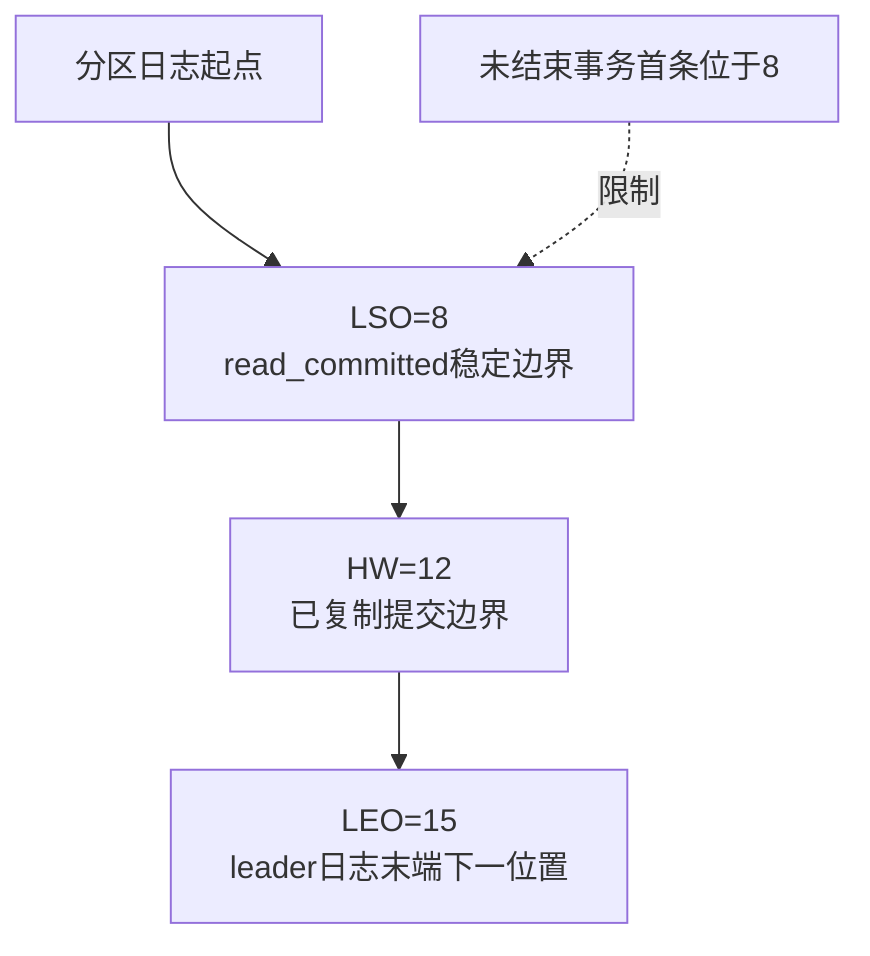
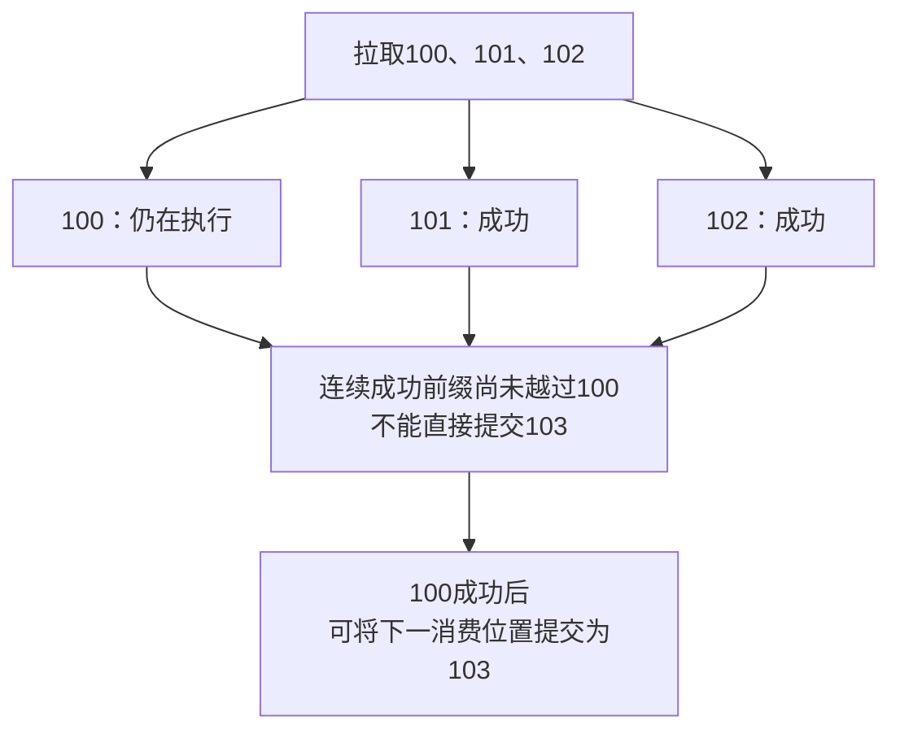

# Kafka 日志复制、事务语义与消费治理深入解析

> 本文以经典 consumer group 为主要模型，兼顾 Kafka 3.9/4.x。Kafka 4.x 使用 KRaft 控制平面，旧 ZooKeeper 控制流程不是当前默认；新协议、share group 和具体默认配置请按部署版本核对。

**阅读主线**：日志与复制边界 → 消费位置 → 事务范围 → 积压恢复。

**快速入口**：[面试题与参考答案](#reference-answers)。

## 阅读目录

- [1. 先区分消息队列与事件日志](#section-1)
- [2. 分区日志：追加、segment 和保留](#section-2)
- [3. 副本、ISR 与写确认](#section-3)
- [4. Producer：批处理、重试和幂等](#section-4)
- [5. 顺序：写入顺序与完成顺序不同](#section-5)
- [6. Consumer poll、重平衡与 offset](#section-6)
- [7. Kafka 事务与 Exactly once](#section-7)
- [8. Outbox + Inbox：把重复变成可处理情况](#section-8)
- [9. 重试、死信与保序取舍](#section-9)
- [10. Schema 演进与权限](#section-10)
- [11. 容量、积压与恢复](#section-11)
- [12. 故障实验](#section-12)
- [13. 面试题与参考答案](#section-13)
- [14. 官方资料](#section-14)

<a id="section-1"></a>

## 1. 先区分消息队列与事件日志

Kafka 将分区日志保留一定时间或按压缩策略处理，消费位置由消费者维护。消费成功不会像传统删除式队列那样自然删除消息，因此不同组可以独立重放、构建不同读模型。

事件应表达已经发生的事实，例如 OrderPaid；命令表达希望某个服务做什么，例如 CapturePayment。二者权限、重试和失败语义不同，不要为了“事件驱动”把需要明确拒绝结果的业务调用全部变成不可追踪的广播。

### 1.1 核心对象关系

| 对象 | 含义 | 设计关注 |
| --- | --- | --- |
| Topic | 逻辑事件流 | 归属、schema、保留和权限 |
| Partition | 有序日志及并行单元 | key 分布、吞吐、顺序边界 |
| Offset | 分区内位置 | 不是跨分区全局业务序号 |
| Consumer group | 一类消费职责 | 扩容上限、重平衡和提交 |
| Replica/ISR | 分区副本及同步集合 | 可靠性、可用性和恢复 |
| Controller/KRaft quorum | 元数据管理 | 与业务分区数据复制区分 |

<a id="section-2"></a>

## 2. 分区日志：追加、segment 和保留

日志按 segment 组织，顺序追加有利于批量 I/O 和操作系统页缓存。Kafka 的高吞吐不是因为“只写磁盘所以快”，而是批处理、压缩、顺序访问、缓存与网络传输共同作用。

时间或大小保留通常按段管理，不保证某条消息到期的那一毫秒就消失。压缩 topic 保留 key 的较新状态，仍不是关系数据库的即时唯一行语义；压缩时机、墓碑和消费者落后都要考虑。

### 2.1 删除和压缩解决不同问题

delete 关注时间/大小边界，compact 关注同 key 历史状态的收敛。订单完整审计日志和“最新用户配置”读模型对历史需求不同，不能不问需求就统一压缩。

<a id="section-3"></a>

## 3. 副本、ISR 与写确认

leader 负责对应分区的主要请求，副本跟随日志。ISR 表示满足相应同步要求的副本集合，集合可变化；设置 replication.factor=3 不意味着此刻三份都健康同步。

### 3.1 acks 与 min.insync.replicas 的组合

acks=all 要求按当前相应副本条件确认，min.insync.replicas 限制允许成功写入时的最小 ISR 要求。比如副本数 3、min ISR 2，可以在损失一个同步副本时继续满足设定条件；进一步故障时可能拒绝写入，以可用性换更高数据安全。

acks=all 不等于每条消息都 fsync 到所有机器磁盘，更不等于任意故障都不丢。恢复、故障选举策略、机架/可用区部署和存储条件共同决定风险。

### 3.2 为什么未充分同步副本不能随意选主

### 3.2.1 LEO、HW 与 LSO：三个边界不相同

**图 1｜LEO、HW 与 LSO：三个边界不相同**



**图解**：数字仅用于解释边界，offset 小于边界的记录才属于相应范围。LEO 表达日志末端下一位置；HW 与分区复制提交有关；事务场景中的 LSO 还受最早未结束事务限制，read_committed 不能把开放事务中的记录当作已完成结果读取，已回滚记录也会被过滤。

因此 read_committed 看起来“落后”不一定是消费者处理慢：开放事务本身可能阻挡稳定可见范围。排查应分别看生产事务状态、分区复制和消费者处理进度。ISR 是动态同步副本集合，不是固定等于法定多数；数据分区确认机制也不能与 KRaft 元数据多数复制混为一谈。

允许落后副本成为 leader 可以恢复服务，但可能丢失此前已存在于其他副本的记录。业务必须明确数据安全与可用性的选择，不应在事故时无记录地改配置只为变绿。

<a id="section-4"></a>

## 4. Producer：批处理、重试和幂等

producer 缓冲消息并按分区形成批次，批次大小和 linger 等策略在吞吐与延迟间取舍。压缩在批次层面更有效，选择算法要测 CPU、带宽及压缩率。

### 4.1 四类发送结果

1. 明确成功：获得 broker 确认，但业务消费未必完成。
2. 明确不可重试失败：schema/权限等错误，需要修复请求或配置。
3. 可重试暂时故障：保留消息身份，在剩余 deadline 内重试。
4. 结果不明确：响应丢失或超时，消息可能已经入日志。

第四类是产生重复的核心原因之一。不能因为“发送方法抛异常”就为业务创建一个全新事件身份。

### 4.2 幂等 producer 的保证范围

幂等生产通过 producer 身份、序列等机制抑制特定发送重试重复，并要求相关配置彼此兼容。它并不识别“同一笔订单被应用层主动构造两条不同消息”的业务重复。

应用仍需 event_id、aggregate_id、业务版本和稳定 schema。若服务重启后重新从 outbox 发同一业务事件，消费端仍要能去重。

<a id="section-5"></a>

## 5. 顺序：写入顺序与完成顺序不同

同一分区有日志顺序，经典组内一个分区分配给一个消费者处理。但消费者收到后交给通用线程池并行执行，就可能先完成后面的消息。生产端的 key 路由、重试及分区数变化也影响业务顺序假设。

### 5.1 订单事件的处理方案

可按分区串行处理，简单但一个慢订单拖累同分区；也可按订单 key 串行、跨 key 并行，代价是 offset 连续完成位置管理更复杂。无论何种方式，状态机或版本条件应拒绝旧事件覆盖新状态。

增加分区数可能把同一 key 的后续消息路由到不同分区，扩容前要规划迁移/截断边界，而不是宣称“同 key 永远同一个分区”。

<a id="section-6"></a>

## 6. Consumer poll、重平衡与 offset

消费者向组协调机制表明活性，并在 poll 中获取记录。max.poll.interval、会话/心跳等参数各有语义，实际新旧协议有差别；耗时业务不应仅靠无限调大超时维持假活跃。

重平衡可能撤销原分区分配，旧执行任务需停止或通过业务 fencing 防止在失去所有权后继续提交错误结果。回调中完成必要清理，但不要无界阻塞整个协调过程。

### 6.1 自动提交与手动提交

提交的是下一次恢复消费的位置，而不是“这些业务副作用已绝对成功”的天然证明。若位置已提交而业务还没持久化，重启后可能跳过未完成处理；先持久化再提交则会在确认失败时重复。

```text
记录 100：慢，尚未成功
记录 101：快，已经成功
若直接提交 102，崩溃后会跳过 100
所以并行消费必须维护连续成功边界，而不是提交最大已完成 offset
```

### 6.2 pause/resume 的用途

### 6.2.1 并行执行为何必须提交连续成功前缀

**图 2｜并行执行为何必须提交连续成功前缀**



**图解**：commit 的 offset 是恢复位置，不是最大已完成任务编号。若跳过未完成洞，崩溃后就永远跳过该业务。实现可维护分区有序在途表与完成位图，只有从当前已确认边界起连续成功的部分才能推进；分区被撤销时还需停止旧任务或防止旧持有者继续操作。

应用容量不足时暂停某些分区拉取，保留必要 poll/协调，待在途任务下降后恢复。具体线程安全和 API 使用遵循客户端要求；不要从任意业务线程无同步调用非线程安全 consumer。

<a id="section-7"></a>

## 7. Kafka 事务与 Exactly once

Kafka 内部读—处理—写可以通过事务 producer 和消费隔离等机制，将目标 Kafka 写入和源 offset 形成相应原子范围。Kafka Streams 提供更高层封装，但仍要理解处理拓扑及外部副作用。

### 7.1 read_committed 解决什么

消费者按隔离级别避免将未完成或回滚事务的记录作为已提交结果处理。开放事务过长可能影响下游可见性和积压判断，因此事务有时限且必须及时完成。

### 7.2 为什么不能自动保证数据库只扣一次

数据库事务和 Kafka 事务属于不同资源范围。应用可能数据库提交成功，Kafka offset 未提交；重放时数据库再扣一次。需要数据库 inbox 唯一约束与业务更新在同一事务，或者其他可证明的协调协议。

外部支付连数据库事务也不能自动包含，必须稳定幂等请求号、查询和对账。Exactly once 必须附带“在哪个系统、哪个故障模型、哪个处理范围内”这三个限定。

<a id="section-8"></a>

## 8. Outbox + Inbox：把重复变成可处理情况

```sql
CREATE TABLE consumer_inbox (
  consumer_name VARCHAR(64) NOT NULL,
  event_id VARCHAR(64) NOT NULL,
  processed_at DATETIME(6) NOT NULL,
  PRIMARY KEY (consumer_name, event_id)
);
```

同一事件会被不同消费者组执行不同职责，因此去重键带消费语义。事务内先尝试插入去重身份并执行条件业务更新，提交后再确认 Kafka；唯一冲突时按驱动/事务语义退出重复路径，不能让失败事务继续假装成功执行。

inbox 清理周期必须覆盖保留和人工重放窗口。若一个月后要回放历史，而去重只保留一天，应采用新的重建目标、可重入更新或另设计回放身份，不能直接发进生产扣款消费者。

<a id="section-9"></a>

## 9. 重试、死信与保序取舍

暂时故障采用有限退避和抖动；永久无效消息不要无限重试阻塞分区。重试 topic 能隔离慢失败，但消息离开原流后，后续事件可能先执行，因此需要业务版本或严格保序策略。

死信至少保存原 topic/partition/offset、event_id、schemaVersion、错误分类、次数和最后失败时间。提供按条件重放、审批/操作记录及重放限速；死信条数归零也不能证明业务没有丢失，可能只是被错误丢弃。

<a id="section-10"></a>

## 10. Schema 演进与权限

事件结构版本明确：新增可选字段一般比删除/改变含义更易兼容；消费者不得假定未知枚举一定不会出现。生产者与消费者滚动升级期间，旧新版本应有重叠兼容窗口。

topic ACL 控制读写，消息中的 tenant_id 还需业务验证。敏感信息最小化，保留与删除策略要符合组织要求；无限事件保留可能让修正错误数据变得困难。

<a id="section-11"></a>

## 11. 容量、积压与恢复

粗估原始存储为写入字节/秒 × 保留秒数 × 副本数，另加压缩差异、索引、段和重平衡余量。消费者必须留恢复能力：如果生产每秒 10,000，消费峰值也只有 10,000，故障停一小时后的积压无法在不降生产的情况下追平。

假设恢复后消费 15,000/秒，生产仍 10,000/秒，净消化 5,000/秒；一小时积压 3,600 万条，理论至少约两小时追平，实际还受下游容量和重试影响。

### 11.1 观察什么

| 指标 | 含义 | 不能直接推断 |
| --- | --- | --- |
| offset lag | 消费位置差 | 不一定等于精确业务条数或秒 |
| 最老未处理事件年龄 | 业务延迟 | 需可信时间和时钟处理 |
| ISR 变化/欠复制 | 副本健康 | 不等于已经丢数据 |
| 生产重试/错误 | 写入可靠性压力 | 重试增多不一定业务重复 |
| DB 等待/拒绝 | 下游瓶颈 | 不能只靠扩消费者解决 |

<a id="section-12"></a>

## 12. 故障实验

1. 生产端在确认前断网，验证同一事件身份被保留。
2. 消费数据库提交后、offset 提交前终止进程，验证重复不重复生效。
3. 让某分区毒消息持续失败，验证重试隔离及有序规则。
4. 增加消费者超过分区数，观察经典组有效并行度而非进程数。
5. 模拟一个 broker 故障，记录 ISR、发送失败和恢复窗口。
6. 重放历史到隔离读模型，验证 schema 兼容、版本及总量，不直接冲击生产写业务。

实验报告包括版本、拓扑、配置、故障时间线、消息身份和数据库状态，足以让另一位工程师复现。

<a id="reference-answers"></a>

<a id="section-13"></a>

## 13. 面试题与参考答案

### Q1：acks=all 是否意味着所有副本落盘且绝不丢失？

**参考答案**：不是。它与当前 ISR、min.insync.replicas 等设置共同决定写成功所需复制条件，replication.factor 只说明副本配置数量。复制确认不等于每条消息 fsync 到所有副本；落后副本选举、故障域和存储故障仍会影响安全性。应明确容忍的节点/区域故障，并对成功、拒绝写入和恢复窗口进行演练。

### Q2：Kafka 的 Exactly once 能保证数据库只扣一次款吗？

**参考答案**：Kafka 内部事务可以协调 Kafka 目标写入与源 offset 等相应范围，配合消费隔离避免读取未提交结果，但外部数据库和支付服务不会自动参与。消费数据库提交后 offset 未提交会导致重放，需要 inbox 与业务更新同事务；支付则依赖稳定幂等请求号、查询和对账。必须说明保证范围，不能把流处理语义扩成任意副作用恰好一次。

### Q3：并行消费为何不能提交最大完成 offset？

**参考答案**：后面的任务完成不证明前面的完成，提交最大位置会在崩溃恢复时跳过空洞。应按分区记录在途任务和完成状态，仅推进连续成功前缀；或者使用更简单的分区串行。重平衡撤销时同步处理所有权和未完成任务，避免旧消费者继续提交或产生冲突副作用。

### Q4：怎样处理一小时积压？

**参考答案**：先定位是生产突增、热点分区、毒消息还是下游慢，再算净消化速度。若生产1万条/秒、恢复消费1.5万条/秒，净消化仅5000条/秒，3600万条理论需约两小时。扩容受分区和下游容量限制，应限速恢复并隔离坏消息，观察最老事件年龄和数据库等待。单纯堆消费者可能制造第二次事故。

<a id="section-14"></a>

## 14. 官方资料

- [Kafka 设计](https://kafka.apache.org/design/)
- [Kafka 4.1 文档](https://kafka.apache.org/41/)
- [Kafka 源码：固定对应 release tag](https://github.com/apache/kafka)
