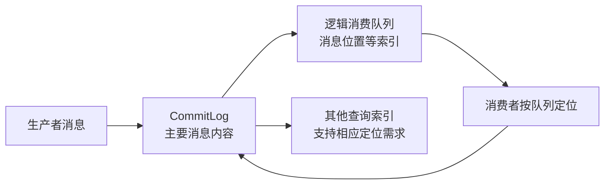
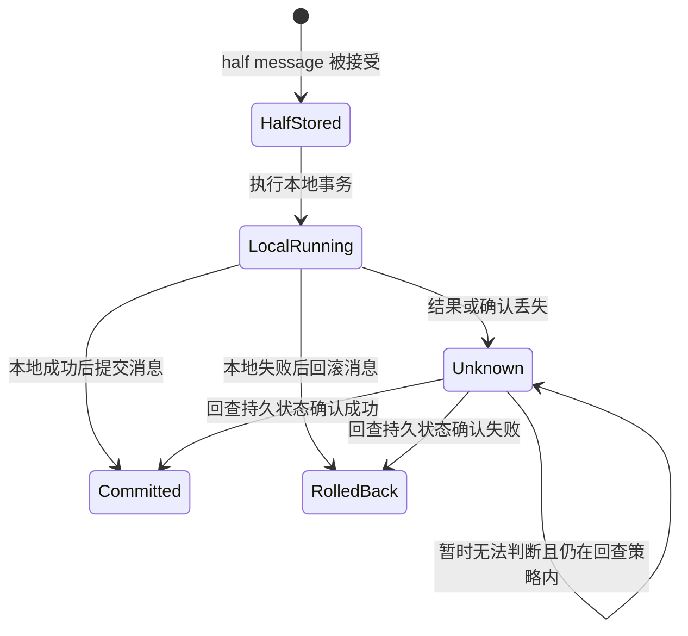
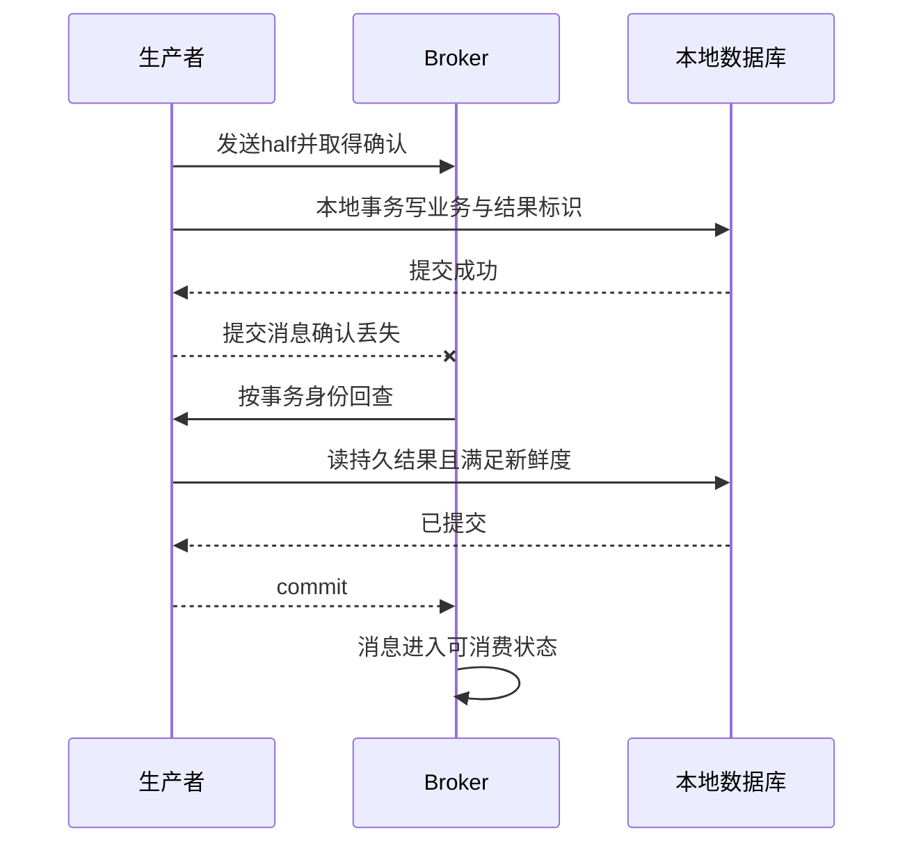

# RocketMQ 存储、投递、事务与顺序消息深入解析

> 基线：RocketMQ 5.x 的业务语义。不同 SDK、Proxy/Remoting 模型及部署方式影响 API 和配置；本文的协议流程不能直接当成某个客户端的完整调用代码。

**阅读主线**：存储确认 → 消费幂等 → 回查决定 → 顺序与延时状态机。

**快速入口**：[面试题与参考答案](#reference-answers)。

## 阅读目录

- [1. 从业务约束看 MQ 选型](#section-1)
- [2. 存储模型：CommitLog 与逻辑索引](#section-2)
- [3. 发送结果：超时不等于没发出去](#section-3)
- [4. 普通消费与确认时机](#section-4)
- [5. 事务消息完整状态机](#section-5)
- [6. 事务消息与 Outbox 的取舍](#section-6)
- [7. FIFO：有序粒度与阻塞成本](#section-7)
- [8. 延时消息：订单关闭的并发证明](#section-8)
- [9. 重试和死信治理](#section-9)
- [10. 容量与积压排查](#section-10)
- [11. 故障实验](#section-11)
- [12. 面试题与参考答案](#section-12)
- [13. 官方资料](#section-13)

<a id="section-1"></a>

## 1. 从业务约束看 MQ 选型

下单后发送通知，可以接受延迟和重复，但不能重复给用户发放权益；支付成功事件要求可靠送达，但生产者不希望等待所有消费业务完成；订单超时关闭需要未来触发，又必须与支付竞争正确处理。

这些需求分别涉及异步解耦、投递可靠性、消费幂等、延时和状态机。MQ 只能提供其中一部分机制，应用仍负责业务身份及事实约束。

### 1.1 核心实体

| 实体 | 职责 | 设计点 |
| --- | --- | --- |
| Topic | 聚合一类消息 | 类型、权限、保留、归属 |
| Message | 载荷与元信息 | 唯一业务事件 ID、schema、追踪 |
| Queue | 路由与存储/消费并行单位 | 热点、有序粒度 |
| Producer | 发送业务事实/命令 | 超时、重试、事务回查 |
| Consumer group | 一种消费职责 | 消费位置、重试、扩容 |
| Broker/Proxy 等 | 存储、服务与协议协作 | 部署模型、故障域与资源 |

Tag 用于筛选，不是安全边界；一个消费者不应仅靠过滤表达式获得跨租户数据访问资格。

<a id="section-2"></a>

## 2. 存储模型：CommitLog 与逻辑索引

理解经典存储路径时，可将 CommitLog 看作主要顺序消息记录，ConsumeQueue 等结构提供按 topic/queue 消费的逻辑定位，索引结构支持部分查询。5.x 某些队列类型及存储优化有专门实现，应看固定版本源码，不能用旧版一张图解释所有新能力。

顺序写与页缓存有利于吞吐，但发送成功究竟代表到内存、落盘还是复制完成，取决于部署和确认配置。同步刷盘与同步复制也不是同一维度，分别应对单机进程/机器故障及副本风险。

### 2.1 可靠性要写成故障矩阵

**图 1｜可靠性要写成故障矩阵**



**图解**：这是经典存储路径的职责图，不是所有 5.x 队列实现逐字节布局。消费队列提供逻辑定位，消息内容由主要存储读取，因此“确认消费”与“物理文件立即删除”是两件事。保留策略会影响故障后是否仍可回放，业务确认并不替代长期审计存储。

| 故障 | 需要的机制 | 仍有的成本 |
| --- | --- | --- |
| 生产者进程崩溃 | 本地 outbox 或事务消息协议 | 扫描、回查和恢复 |
| broker 进程/机器故障 | 持久化与复制 | 延迟、存储和可用性取舍 |
| 确认响应丢失 | 稳定消息身份、幂等 | 可能重复投递 |
| 消费者提交后崩溃 | 本地幂等与确认顺序 | 去重保留和重放策略 |

<a id="section-3"></a>

## 3. 发送结果：超时不等于没发出去

生产者发出请求后，broker 可能已接受消息，只是确认未返回。应用如果生成新业务 ID 重试，就把一次业务事实变成两条无法识别的事件。

消息 ID 与业务 event_id 不一定相同。broker 分配的技术身份有助于定位，业务 event_id 应由可靠生产流程稳定生成，重复发送保持不变。将业务主键、操作类型和版本纳入消息内容，支持消费者判断因果关系。

重试必须受总 deadline、次数及可重试错误分类约束。权限错误、无效 schema 不应持续重试；网络故障重试要退避，防止 broker 恢复时出现发送风暴。

<a id="section-4"></a>

## 4. 普通消费与确认时机

确认必须在业务结果持久化后。若先确认再写数据库，崩溃可能丢业务处理；先写后确认则可能重复，因此业务幂等不是可选补丁，而是可靠消费的组成部分。

### 4.1 幂等的三种常见形式

1. 事实唯一：例如权益发放表 UNIQUE(user_id, campaign_id, grant_type)。
2. 事件去重：inbox UNIQUE(consumer_name, event_id) 与业务变更同事务。
3. 状态条件：只有符合前态和版本的状态迁移才能更新成功。

三者可组合。只缓存“处理过”标记再执行数据库写，会产生标记成功但业务失败的窗口；只执行数据库再标记又会重复。因此边界必须放在同一事实存储的原子操作里。

### 4.2 重复消费不一定应返回错误

去重确定先前结果成功时，正常确认重复消息即可；若同一 ID 携带不同内容，应报警并拒绝把它当正常重试。去重记录包含请求摘要或关键版本有助于发现生产者身份复用问题。

<a id="section-5"></a>

## 5. 事务消息完整状态机

**图 2｜事务消息完整状态机**



**图解**：half阶段不向普通消费者公开；本地结果明确则给最终决定，结果不明才进入回查。Unknown表示需要继续判定，不是重新执行原业务。

### 5.1 本地事务的判断依据

**图 3｜本地事务的判断依据**



**图解**：回查解决的是二阶段决定不明确，而不是重新执行本地事务。若回查再次扣库存，会把恢复流程变成重复业务。结果查询需用稳定事务身份，且数据库记录与原业务同一事务提交；查滞后副本可能误判尚未完成。

对于“查不到”，协议要区分本地尚在执行、已确定失败和暂时不可判断：可以结合持久事务状态、执行期限和事实源返回 unknown，不能把一次空查询无条件当作 rollback。超过回查窗口的异常必须进入告警与人工恢复，不能仅靠内存重试计数。

本地事务内同时写业务状态与事务结果标识。回查根据事务 ID 查询该标识，而不是依赖内存 boolean、线程是否仍运行或最近一条日志。

“查不到记录”不一定立刻等于回滚：本地事务可能尚未提交，或查询使用滞后副本。回查路径要使用符合新鲜度要求的事实源，并结合执行截止时间和明确状态规则判断。

### 5.2 回查本身也会失败

回查会访问数据库，数据库故障时可能返回 unknown。需要限制回查成本，设置合理期限，观察最长 unknown 年龄及次数；超过协议窗口后如何人工修复要有运行手册，不能假定 broker 永远替你保留并重试。

### 5.3 事务消息没有覆盖消费者事务

事务消息主要协调生产者本地事务与消息可见性。消费者数据库写、外部支付、下游短信仍要独立处理失败，不会因为生产使用了事务消息就自动全链路原子提交。

<a id="section-6"></a>

## 6. 事务消息与 Outbox 的取舍

| 维度 | 事务消息 | Outbox |
| --- | --- | --- |
| 核心原子点 | 本地事务状态 + broker 协议/回查 | 业务表与 outbox 同库事务 |
| 恢复者 | broker 回查 + 生产者查询 | 投递器/CDC 扫描 |
| 组件耦合 | 依赖对应 broker/SDK 能力 | 依赖数据库与投递通道 |
| 重复 | 仍需消费幂等 | 仍需消费幂等 |
| 运维关注 | unknown、回查、保留窗口 | 积压、领取、投递与清理 |

选择时考虑团队是否能长期维护回查服务、是否已有 CDC，以及多消息通道需求。不要为了技术偏好在同一路径叠两套协议而没人理解最终状态。

<a id="section-7"></a>

## 7. FIFO：有序粒度与阻塞成本

FIFO 消息需满足消息组路由和相应生产消费约束。同一订单使用稳定消息组表达局部顺序，比整站全局单流更易扩展；单个热点组仍可能成为瓶颈。

如果一个消息失败，坚持保序可能阻塞该流后续消息。跳过或移入重试流会改变顺序假设，必须由业务状态机支持。例如已支付事件不能被晚到的待支付更新覆盖。

多个生产者同时产生同一实体事件时，即便消息按到达顺序存储，也不证明那是业务因果顺序。版本、来源及冲突处理仍需显式设计。

<a id="section-8"></a>

## 8. 延时消息：订单关闭的并发证明

发送“30 分钟后检查订单”的消息，不代表到时无条件关闭。消费者应检查事实源中的截止时间和当前状态，以条件写入完成合法迁移。

```sql
UPDATE orders
SET status = 'CLOSED', version = version + 1
WHERE id = :order_id
  AND status = 'PENDING'
  AND expire_at <= CURRENT_TIMESTAMP;
```

支付回调同样要检查合法前态。如果已经关闭后支付方才返回成功，需要进入退款/人工处理等明确流程，而不是简单覆盖成 PAID。状态机必须回答延时、乱序、重复和结果不明四种情况。

延时服务可能晚到，补偿扫描查询已到期仍待处理的记录，使用相同条件操作。补偿与消息并行运行仍要幂等，不能让“兜底”制造第二次副作用。

<a id="section-9"></a>

## 9. 重试和死信治理

失败分为暂时依赖故障、数据永久无效、权限/配置问题及程序缺陷。自动重试只适合有可能恢复且可重复执行的情况；无效数据无限重试只会堵塞队列并制造告警噪声。

死信流程必须有归属人、原因分类、处置 SLA、修复数据的方法、重放范围和速率控制。重放前验证旧 schema 与当前消费者兼容，保留原 event_id，让幂等机制继续有效。

<a id="section-10"></a>

## 10. 容量与积压排查

从生产速率、可用队列/消息组并行度、单条执行时间和下游容量计算理论上限。消费者进程增加不代表瓶颈自动消失：热点 FIFO 组、数据库锁、连接池和远端限流都可能仍然串行。

监测发送成功/不明结果、消费延迟、重试次数、最老未处理年龄、事务 unknown 和死信年龄。只看总积压会掩盖一个关键订单卡很久但整体数量不大的情况。

恢复阶段按净消费速度估算追平时间，设置下游保护，避免把积压一次灌入数据库。需要业务优先级时使用隔离流和配额，不用人工随机跳消息。

<a id="section-11"></a>

## 11. 故障实验

| 注入点 | 预期行为 | 验证依据 |
| --- | --- | --- |
| half 成功后进程停止 | 回查恢复最终决定 | 本地持久事务状态 |
| 本地提交后提交消息失败 | 最终消息可见，不撤销业务事实 | 回查与消费记录 |
| 消费提交后确认前停止 | 允许重投，副作用一次 | inbox/业务唯一约束 |
| 延时与支付并发 | 状态合法，无无声覆盖 | 条件更新和补偿记录 |
| poison message | 有限重试并进入可处理流程 | 死信及告警 |
| 恢复大积压 | 不超过下游预算 | DB 并发、拒绝率和追平时间 |

<a id="reference-answers"></a>

<a id="section-12"></a>

## 12. 面试题与参考答案

### Q1：事务消息回查应该查什么，为什么不能重做业务？

**参考答案**：回查按稳定事务 ID 查询与本地业务原子提交的持久结果，返回提交、回滚或暂不明确。它补全先前决定，不重新执行扣减、发券等动作。若业务已提交但消息确认丢失，重复执行反而产生第二次副作用；只读进程内标志又无法跨重启恢复。

### Q2：回查查不到记录是否可以直接回滚？

**参考答案**：不一定。事务可能仍未提交，查询也可能来自滞后副本，或者数据库暂时不可用。应按协议区分进行中、确定失败及无法判断，使用满足新鲜度要求的事实源和明确执行期限；允许时返回 unknown，并对超期状态告警。回查次数与保留窗口是有限资源，不能假定 broker 永远替应用兜底。

### Q3：有延时消息为什么还要扫描关闭订单？

**参考答案**：延时投递不是精确实时调度，消息可能晚到、重复或超过恢复窗口。扫描按事实源的到期时间和状态补偿漏处理，消息与扫描共用条件更新，防止重复关闭。支付竞争也必须经过状态机，若关闭后出现成功支付，进入明确退款/异常处理流程，而不能让两个终态互相覆盖。

### Q4：FIFO 是否保证多个生产者对同一订单的业务因果顺序？

**参考答案**：不是无条件保证。消息组及相应发送/消费约束决定局部顺序，多个来源并发产生事件时，broker 的接收次序不一定等于业务因果顺序。应统一事件产生入口、携带单调业务版本并验证状态迁移；消费异步并行、失败跳过和重试流也可能破坏完成顺序，需要明确保序范围与阻塞成本。

<a id="section-13"></a>

## 13. 官方资料

- [事务消息](https://rocketmq.apache.org/docs/featureBehavior/04transactionmessage/)
- [FIFO 消息](https://rocketmq.apache.org/docs/featureBehavior/03fifomessage/)
- [消费重试](https://rocketmq.apache.org/docs/featureBehavior/10consumerretrypolicy/)
- [RocketMQ 源码](https://github.com/apache/rocketmq)
