# Kubernetes 原理：从容器编排到控制循环与故障恢复

> **阅读目标**：把一次声明从 API 写入、调度、运行、接流量到故障恢复连成模型，能解释每个抽象解决什么问题、依赖谁、失败时保证到哪里。
>
> **内容定位**：架构、知识和推演，配少量机制示例；不以安装步骤和大段资源清单为主。搭配 [Kubernetes 面试](Kubernetes面试.md) 练习表达。缩写首次解释，完整术语在文末。
>
> **版本口径**：讲解现代 Kubernetes 1.x 的稳定机制，标记关键版本节点；版本状态按 **2026-11-09** 查阅的官方资料整理。插件、云平台、内核和功能门控会改变具体能力，不能由集群版本号独自推断。

## 阅读导航

| 主线 | 快速跳转 | 必须能解释 |
|---|---|---|
| 控制模型 | [演进](#k-01) → [组件](#k-02) → [API 与控制循环](#k-03) | 为什么声明成功不等于应用已运行？ |
| 应用生命 | [Pod](#k-04) → [探针与停止](#k-05) → [工作负载](#k-06) → [发布与中断](#k-07) | 重启、替换、迁移、回滚有何区别？ |
| 资源与位置 | [调度](#k-08) → [资源](#k-09) → [伸缩](#k-16) | 为什么 CPU 空闲仍 Pending？扩容为何无效？ |
| 网络入口 | [Pod 网络](#k-10) → [Service 与 DNS](#k-11) → [Ingress/Gateway](#k-12) | 找到名字、能连通、正确路由分别由谁负责？ |
| 数据与权限 | [存储](#k-13) → [配置](#k-14) → [安全](#k-15) | Pod 重建为什么可能保留数据，也可能丢数据？ |
| 平台工程 | [高可用](#k-17) → [扩展与交付](#k-18) → [排障](#k-19) → [版本](#k-20) | 集群健康如何转化为业务可靠性？ |

原笔记 [基础概念](尚硅谷_Kubernetes基础概念.md)、[核心实战](尚硅谷_Kubernetes核心实战.md) 保留为历史实验记录；旧命令、镜像和组件版本应放回当时环境理解。

## 1. 从物理机、虚拟机、容器到编排：问题怎样演变

> 🎯 **核心结论**：容器解决应用打包与进程隔离，Kubernetes 协调大量应用实例的期望状态；它没有让网络、存储和业务状态自动变可靠。

### 1.1 每一步抽象带来了什么

| 形态 | 主要收益 | 留下或新增的问题 |
|---|---|---|
| 物理机直接运行应用 | 路径直接，管理层少 | 环境依赖、资源争抢、故障恢复靠人工 |
| 虚拟机 | 通过独立客户机系统增强隔离与资源管理 | 镜像较重，应用发布与实例治理仍需平台 |
| 容器 | 应用及依赖打包，启动快，共享宿主内核 | 单机运行时不负责集群放置、入口与持久化协调 |
| Kubernetes | 调度、控制循环、服务与资源接口 | 引入分布式控制面和插件生态，业务协议仍由应用负责 |

虚拟机与容器可以叠加使用，并非只能二选一。容器隔离依赖内核与运行时，不等于每个容器拥有独立内核；安全边界和运维边界必须分别分析。

**读图**：编排接管的是协调，不是把容器变成永不失败的机器。自动重建对无状态副本较直接，对数据库主节点则需要额外的状态与选主协议。

### 1.2 为什么选择声明式，而不只提供远程脚本

命令式脚本描述“启动三份、停止这一份”，中途失败后必须知道执行到哪一步；声明式描述“应当有三份”，控制器持续比较观察结果并补差。进程重启、事件重复或漏看之后，可重新观察当前状态继续收敛。

代价是异步与最终收敛：请求返回不等于资源可用，错误需要通过状态、条件和事件理解。脚本仍能用，但最好表达有限操作或驱动声明，不应与控制器长期争抢同一状态。

## 2. 控制面与数据面：谁做决策，谁实际运行

> 🎯 **核心结论**：API Server 统一访问对象，控制器持续协调，调度器选择位置，kubelet 管节点执行；应用流量通常不经过控制面。

### 2.1 组件图与职责

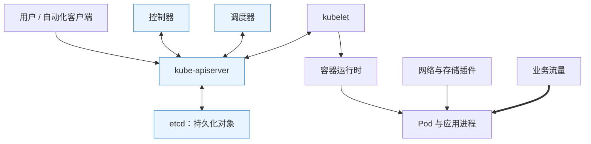

**读图**：图中的双向箭头表达经 API 读写与观察，不表示每个请求都同步经过所有组件。核心组件通常通过 API 协作，而非调度器直接去 etcd 写一条再远程登录节点启动容器。

| 组件 | 主要工作 | 不应混淆 |
|---|---|---|
| kube-apiserver | API（Application Programming Interface，应用程序编程接口）访问、校验及持久化入口 | 不亲自启动所有应用容器 |
| etcd | 存储集群对象等控制状态 | 不自动保存所有应用数据库内容 |
| kube-scheduler | 为尚未绑定的 Pod 选择合适节点 | 不负责镜像拉取和持续执行 |
| kube-controller-manager | 运行多类控制循环 | 不是唯一包办所有组件的总调度线程 |
| kubelet | 按节点分配与配置协调运行状态 | 不替代全局调度器 |
| 网络/存储组件 | 实现流量和卷相关能力 | 不因对象创建就必然存在可用实现 |

控制面节点与工作节点不必数量相等；单节点环境也可兼任角色，生产隔离与高可用是另一个设计问题。部分控制面组件多副本部署后通过 leader election（领导者选举）协调，不能理解为所有控制器都同时无约束执行。

### 2.2 etcd 为什么需要多数派

etcd 通过 Raft 等机制维护一致日志。N 个投票成员通常需要超过一半形成 quorum（法定多数）；3 个需 2 个，可容忍 1 个故障，5 个需 3 个，可容忍 2 个。2 个成员仍需 2 个，并未比单点多出 1 个故障容忍。

更多成员增加复制与确认成本，不是越多越快。成员跨区能分散故障，也会引入写入延迟。备份需要快照、恢复流程和密钥等配套验证，不是复制一次数据目录就足够。[etcd 官方 FAQ](https://etcd.io/docs/v3.6/faq/)

### 2.3 控制面短暂失联，业务会怎样

已有进程和已下发网络规则可能继续运行，既有流量不必立刻停止；但调度、扩缩、端点更新、故障替换与需要 API 的应用会受影响。时间越久、实例变化越多，控制状态和实际状态越可能偏离。

**不能说完全无影响，也不能说全部立即中断**。应拆开现有数据面、控制变更和业务对 API 的依赖。

## 3. API、Watch 与 Reconcile：声明如何逐步变成现实

> 🎯 **核心结论**：写入期望状态只是第一步；控制器通过观察与幂等协调收敛，不能把 Watch 当成恰好一次的业务消息总线。

### 3.1 从请求到运行状态

对象通常包含 metadata、spec 和 status：元数据描述身份与管理关系，spec 表达期望，status 由相关组件报告观察。API 请求还会经过认证、授权、准入、校验等处理，成功持久化后由观察者继续行动。

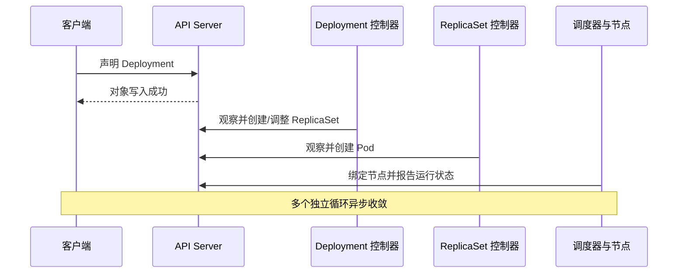

**读图**：`apply` 成功只证明请求阶段成功，不证明镜像存在、节点够用、挂载成功或探针通过。

### 3.2 为什么 List + Watch + 工作队列

List 建立一个视图，Watch 持续观察变化；客户端缓存与工作队列减少反复全量读取。工作项一般表达“这个对象需要重新协调”，控制器取当前状态再计算差异，而不是照着一条事件机械执行一次副作用。

纯周期全量轮询实现简单，但间隔大响应慢、间隔小又增加 API 与存储压力；仅依赖一次事件推送则难以处理断流和遗漏。组合初始视图、增量观察与重新协调，在响应速度、访问成本和可恢复性之间取舍。

Watch 会断开，历史可能被压缩，客户端应重连、重建视图；队列也可能重复触发。**Reconcile（协调循环）应幂等、可重试并处理部分成功**。创建云盘成功但写回状态前退出，重试需能识别已有云盘，不能再无条件创建一块。

### 3.3 三种版本/身份字段

| 字段 | 作用 | 常见误推 |
|---|---|---|
| metadata.uid | 区分对象实例身份 | 同名重建对象不等于原实例 |
| metadata.resourceVersion | 观察位置与并发控制相关令牌 | 不应自行解释为时间或简单全局业务序号 |
| generation / observedGeneration | 关联期望变更与组件已观察版本，依资源而定 | 某条件为真不代表已经处理最新 spec |

更新资源时可基于资源版本检测竞争；冲突后重新读取并计算，而不是不断覆盖别人的修改。SSA（Server-Side Apply，服务端应用）管理字段所有权与冲突，不提供跨资源事务；强制接管可能覆盖其他管理者意图。

### 3.4 删除、OwnerReference 与 Finalizer

OwnerReference 表达所有者关系，垃圾收集器据此处理从属资源；Finalizer（终结器）用于在最终删除前完成外部清理等工作。设置 deletionTimestamp 后，对象可能仍可见，等待相关控制器清除终结器。

Terminating 卡住时先检查谁负责清理和外部状态。直接删 finalizer 可能遗留云盘、负载均衡或其他资源，不应当作没有后果的万能修复。控制器要处理重复清理、外部对象已不存在与权限失败。[API 概念](https://kubernetes.io/docs/reference/using-api/api-concepts/)

## 4. Pod 与运行时：为什么最小调度单元不是一个容器

> 🎯 **核心结论**：Pod 把必须共置、共同管理生命周期的容器组织为一个单元；容器重启与 Pod 替换属于不同层次。

### 4.1 Pod 共享什么

同 Pod 容器通常共享网络命名空间和端口空间，可用 localhost 互访；可以共享声明的卷。它们并非默认共享所有文件系统或进程命名空间，进程共享需看配置。

把日志代理、流量代理等紧耦合辅助进程放同 Pod，便于共置与本地通信；把所有微服务塞一起，会让它们被迫共同调度、伸缩和发布。

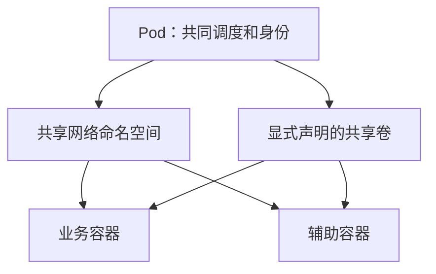

**读图**：共享来自明确的命名空间与挂载，不表示所有容器目录完全相同。一个 Pod 可以有一个或多个容器，也不能把 Pod 简单等同一个 Docker 容器。

### 4.2 kubelet、CRI、OCI 与镜像

CRI（Container Runtime Interface，容器运行时接口）连接 kubelet 与容器运行时服务；OCI（Open Container Initiative，开放容器倡议）定义镜像和运行等标准。containerd、CRI-O 等可承接相应运行时职责。

Kubernetes 1.24 移除内置 dockershim，不表示 Docker 构建的兼容 OCI 镜像不能运行；Docker Engine 若作为运行时接入，需要合适适配，不再有原内置路径。**构建工具、镜像格式与节点运行时是不同问题**。

### 4.3 生命周期与状态的三个层次

Pod phase、容器状态和 Ready 条件要分开。Running 可表示 Pod 已调度且容器已创建、至少一个在运行或启动/重启过程中，不保证每个容器健康或业务可用。Pod 的 IP（Internet Protocol，网际协议）地址也不应当作持久业务身份。

容器退出后，kubelet 根据 restartPolicy 等决定是否在同 Pod 内重启；控制器替换 Pod 则产生新 UID（Unique Identifier，唯一标识符），IP 也可能变化。**Pod 不会携带原身份整体搬到另一台机器继续运行**。

CrashLoopBackOff 表示反复失败后的退避状态，通常不是 Pod phase；ImagePullBackOff、ContainerCreating 等显示也需要结合等待原因和事件理解。

### 4.4 Init、Sidecar 与普通多容器

普通 init 容器通常顺序完成后再启动应用容器，适合有界初始化。把永久循环放普通 init，会让业务永远无法启动。

原生 Sidecar 使用可重启 init 容器等机制，能够持续运行并参与受控启动/停止；相关能力在 1.33 稳定。它与把辅助进程放进普通 containers 的传统做法有不同生命周期语义，Job 完成也需区分。[Sidecar 官方说明](https://kubernetes.io/docs/concepts/workloads/pods/sidecar-containers/)

其典型声明位于 initContainers 并设置容器级 restartPolicy=Always；启动达到相应条件后可继续后续初始化，结束应用时则协调辅助容器停止。原生 Sidecar 不必像普通持续运行的辅助容器那样阻止 Job 完成，代理预热与就绪仍需显式设计。

## 5. 探针与优雅终止：活着、就绪、能完成业务不是一件事

> 🎯 **核心结论**：startup 保护启动窗口，liveness 判断是否需重启，readiness 决定是否就绪；终止则需要流量传播和应用停止协议一起配合。

### 5.1 三类探针分别改变什么

| 探针 | 问题 | 失败影响 | 误用 |
|---|---|---|---|
| startup | 应用是否完成启动？ | 达阈值后结束容器并按策略处理；成功前抑制另外两类探针 | 用固定短窗口对待长预热应用 |
| liveness | 当前实例是否陷入应重启才能恢复的状态？ | 达阈值后结束相应容器，按重启策略处理 | 把共享数据库故障变成全体重启 |
| readiness | 当前是否适合接受对应业务流量？ | 影响就绪与常见端点选择，不直接重启 | 用进程存在替代业务可用 |

readiness 不通过通常使普通 Service 路径不再把它作为就绪后端，但不阻止所有直连、已有连接或特殊发布未就绪地址的配置。探针结果传播也不是瞬间完成。

### 5.2 为什么不要把所有依赖都塞进 liveness

数据库短暂变慢时，所有应用一起存活失败，重启又触发建连和预热，可能扩大故障。外部依赖是否影响 readiness，也要看能否提供部分功能、全体摘流后入口如何处理，而不是一律判死。

### 5.3 一次正常终止的大致过程

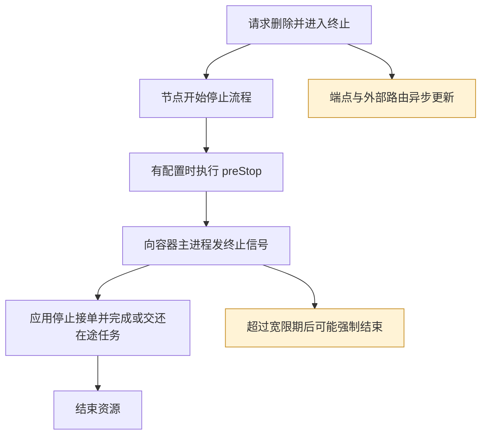

**读图**：端点变化和节点停止不是一个全局串行事务。preStop 通常占用同一终止宽限预算；不能假定宽限期从 hook 完成后才开始。

应用 PID 1（Process Identifier 1，进程号 1）应能接收并正确处理信号，启动脚本也需正确转发。请求耗时、消息确认、后台线程和长连接要有自己的停止协议；固定 sleep 只能争取传播时间，不保证全部链路已摘流。

### 5.4 Pod 退出成功，不等于请求无重复无丢失

进程可能在付款已提交但响应未送达时退出；消息可能处理后未确认。平台负责停止和重建，业务仍需幂等键、结果查询和可恢复状态。强制删除更不能证明旧节点上的进程已经停止。

Spring Boot 的就绪、探针与关闭机制可结合 [Boot 运行原理](../../chapter_02_开发框架/chapter_01_Spring/chapter_02_SpringBoot/SpringBoot原理.md#sb-07) 对照，明确平台与应用各自的职责。

## 6. 工作负载演进：为什么不能所有应用都用 Deployment

> 🎯 **核心结论**：工作负载控制器表达不同的身份、完成和副本语义；选择取决于业务生命周期，不取决于哪份 YAML（YAML Ain't Markup Language，数据序列化语言）清单最熟悉。

| 控制器 | 主要语义 | 适合 | 不自动保证 |
|---|---|---|---|
| Deployment + ReplicaSet | 维护可替换副本并管理版本 | 无状态服务 | 数据库状态复制、金丝雀精准比例 |
| StatefulSet | 稳定序号、网络身份与卷关联 | 需要身份的有状态成员 | 数据库选主、复制与一致性 |
| DaemonSet | 在符合条件节点维护实例 | 日志、网络、节点代理 | 绝对每台机器都无条件一个 |
| Job | 朝完成目标推进任务 | 有限批处理 | 业务恰好执行一次 |
| CronJob | 按日程创建 Job | 周期任务 | 精确一次触发、跨 Job 业务互斥 |

### 6.1 Deployment 为什么多一层 ReplicaSet

Deployment 管版本和发布策略，ReplicaSet 维持某一模板对应的副本。模板变更产生新版本副本集合，旧集合可以保留以辅助回滚。手工删除 Pod 后被重新创建，是上层期望仍要求副本，不是删除命令失效。

### 6.2 StatefulSet 的稳定与不稳定

Pod 名称序号及卷关联相对稳定，Pod UID、进程、IP 与所在节点仍可变化。默认 OrderedReady 体现有序启动等语义，也存在不同管理和更新策略，不能泛化为任何版本、任何配置都严格串行。

保留 PVC（PersistentVolumeClaim，持久卷声明）的历史默认与可配置保留策略要区分。删除工作负载是否保留数据还需检查卷回收策略、控制器设置和存储后端。**StatefulSet 让成员身份可管理，不让三份数据库自动成为复制集**。

### 6.3 Job/CronJob 为什么必须考虑重复

节点失败、控制面观察延迟和重试会造成执行结果不确定；CronJob 的计划也可能出现重复或遗漏。concurrencyPolicy 控制该 CronJob 的相关 Job 并发，不提供对任意外部任务的全局业务锁。

付款、结算、发券等应使用业务时间窗、唯一键和状态机；任务重试先判断之前是否完成。Indexed Job 等特性可以组织工作分片，但不消除副作用重复。[CronJob 官方约束](https://kubernetes.io/docs/concepts/workloads/controllers/cron-jobs/)

### 6.4 静态 Pod 为什么与工作负载控制器不同

静态 Pod 可由 kubelet 根据节点本地配置等方式管理，常用于部分引导方案中的控制面组件。节点可向 API 报告 mirror Pod（镜像 Pod），但 API 中的镜像对象并不是原始声明来源，删除它不等于删除节点本地配置。

这解释了 API 尚未完整可用时某些控制面组件如何先启动，也解释了为何不能把每个可见 Pod 都当成 Deployment 的下级对象。静态 Pod 的更新和约束应按节点管理机制理解。[静态 Pod 官方说明](https://kubernetes.io/docs/tasks/configure-pod-container/static-pod/)

## 7. 发布、回滚与 PDB：保持副本数为何不等于业务无损

> 🎯 **核心结论**：滚动策略控制新旧副本替换，探针与可用性控制推进；中断预算只覆盖部分自愿驱逐，不能提供完整业务可用性保证。

### 7.1 滚动更新中的容量预算

maxSurge 控制期望副本以上允许的增量，maxUnavailable 控制期望副本中的不可用额度；百分比有取整规则，不要按直觉直接相加。终止中的 Pod 仍可能占资源，因此资源占用也不能简单视为永久严格小于 replicas + maxSurge。

对于 Deployment 的百分比策略，maxSurge 向上取整，maxUnavailable 向下取整：3 副本配两者 25%，分别得到 1 与 0。minReadySeconds 还可要求持续就绪一段时间才视为可用，避免探针短暂通过就立刻大量替换旧实例；但它不验证业务数据正确。

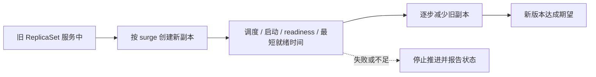

**读图**：maxUnavailable=0 仍需足够节点和正确探针；数据库不兼容、长连接中断和回退不可逆都不由这个数字解决。进度超时被报告，也不等于自动完成回滚。

### 7.2 滚动、蓝绿、金丝雀的不同成本

| 方式 | 优势 | 必须考虑 |
|---|---|---|
| 滚动 | 增量资源较小，原生支持成熟 | 新旧共存契约、逐步终止与容量 |
| 蓝绿 | 可先验证完整新环境再切换 | 双份资源、连接与数据兼容，切流非瞬时 |
| 金丝雀 | 小范围真实流量反馈 | 流量比例、用户粘性、指标与自动停止机制 |

Service 的副本比例不等于精确请求比例，连接复用会影响实际分布。数据库 schema 升级更适合先保持兼容，再逐步迁移；回滚镜像不会自动撤销数据变更。

### 7.3 PDB 具体保护什么

PDB（Pod Disruption Budget，Pod 中断预算）供 Eviction API 等路径判断自愿驱逐是否可接受，例如节点排空。它不能阻止节点突然失效；直接删除 Pod、节点压力驱逐及工作负载滚动更新等路径不能简单按同一保护承诺理解。

滚动更新造成的不可用会影响预算统计，但 Deployment/StatefulSet 的滚动控制主要看自身更新策略，并不被 PDB 当作统一闸门限制。PDB 也不保证替代副本一定有节点可调度。[中断机制说明](https://kubernetes.io/docs/concepts/workloads/pods/disruptions/)

### 7.4 为什么 drain 会卡住

预算不允许、替代实例未就绪、调度或存储不足，都可能阻止顺利排空。应确认影响与补足能力，而不是把强制绕过当常规过程。部署“多副本”同时还需把副本放到不同故障域，否则单节点掉电就能一起丢失。

## 8. 调度：节点空闲，Pod 为什么仍然放不进去

> 🎯 **核心结论**：调度是约束满足与择优，不是看实时 CPU 最低就放过去；资源请求只是可行条件之一。

### 8.1 从队列到绑定

调度器观察尚未绑定的 Pod，过滤不可行节点，对可行节点评分，再按调度流程完成资源预留、等待许可与绑定等阶段。具体由调度框架插件实现；选好节点后，kubelet 和运行时还可能因镜像、卷或本地资源失败。

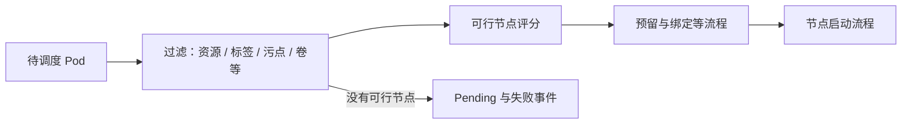

**读图**：Scheduled 只是获得节点，不等于容器已创建；Pending 也可能涵盖已绑定后的准备阶段，应看 Pod 条件与事件。

### 8.2 常见约束如何比较

| 机制 | 表达什么 | 硬/软边界 |
|---|---|---|
| nodeSelector / 节点亲和 | 希望在哪类节点运行 | 必需条件可导致无节点，偏好可让步 |
| Pod 亲和/反亲和 | 与哪些 Pod 接近或分离 | 硬反亲和在容量不足时宁可不运行 |
| Taint / Toleration | 节点排斥与 Pod 容忍 | 容忍只是允许，不保证被选中 |
| TopologySpreadConstraints | 按故障域控制分布偏差 | DoNotSchedule 与软调度行为不同 |
| Priority / Preemption | 优先级与必要时让位 | 不增加总容量，也不能突破所有约束 |

NoSchedule 不赶走已运行 Pod；NoExecute 可以影响已有 Pod，但还看容忍与期限。容忍某节点污点与要求只能去某节点不是同一个目标，后者还需要选择约束。

### 8.3 为什么看 requests，而不直接按实时利用率

CPU（Central Processing Unit，中央处理器）使用是瞬时值，用它承诺未来容量会受到负载波动影响；requests 表达可用于规划的需求，调度器根据已分配请求等计算容量。代价是低请求可能导致竞争，高请求可能造成表面空闲而拒绝调度。

除了 CPU，还要看内存、Pod 数、设备、端口、架构、区域、卷和自定义条件。抢占低优先级 Pod 也无法制造一个满足错误存储区域的节点。默认调度不会因为某节点后来更空闲就自动搬走现有 Pod。[调度器说明](https://kubernetes.io/docs/concepts/scheduling-eviction/kube-scheduler/)

## 9. 资源、QoS、OOM 与驱逐：四个不同的控制层

> 🎯 **核心结论**：requests 主要用于规划与部分资源分配，limits 影响运行约束；容器超限、节点压力和调度失败需要不同解释。

### 9.1 requests 与 limits 不是两种同等硬预留

| 项目 | 主要含义 | 超过时通常怎样 |
|---|---|---|
| CPU request | 调度容量与竞争时相对份额等依据 | 有空闲且无限制时可用更多 |
| CPU limit | 常见 Linux 配额约束 | 节流，延迟上升，不是直接 OOM |
| 内存 request | 调度与压力处置参考 | 可用更多，但不表示不会遭遇压力 |
| 内存 limit | 运行内存边界 | 可能触发内核 OOM 处理，并非平滑降速 |
| 临时存储 | 可写层、日志与本地临时卷等相关占用 | 超限/节点压力可能引发驱逐 |

OOM（Out of Memory，内存不足）可能发生在容器限制或节点整体压力下。Exit Code 137 常与 SIGKILL 相关，**不是只凭数字就能确定原因**，还应看 OOMKilled、节点事件、指标与内核证据。

### 9.2 QoS 是如何形成的

QoS（Quality of Service，服务质量）传统上分 Guaranteed、Burstable、BestEffort，与 CPU/内存 requests 和 limits 的配置关系相关。Guaranteed 的传统容器级判定要求相关容器 CPU、内存都设置请求与限制且分别相等；新特性的 Pod 级资源还需按目标版本核对。

QoS 有助于解释资源保障，但节点压力驱逐并非永远固定按三个标签机械排序。是否超过请求、Pod 优先级和相对使用情况等都影响实际选择；Guaranteed 也不能保证节点永不失败或进程永不被结束。

### 9.3 三种失败要分清

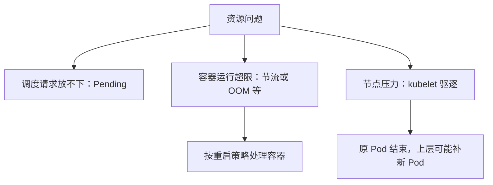

**读图**：容器重启不等于 Pod 被驱逐；Pod 被驱逐也不等于被原样迁走。需要检查 reason、容器最后状态和控制器补建情况。

### 9.4 应用运行时与容器边界

Java 堆不等于容器全部内存，堆外、线程栈、代码缓存和进程其他开销仍需预算。将堆设置得接近内存 limit，可能在堆还有余量时容器已被 OOM。CPU limit 也可能使探针和请求排队超时。

memory-backed emptyDir 使用内存，不能当作免费磁盘缓存。资源配置要同时看峰值、尾延迟、节流、OOM、节点余量与成本，而不是只追求平均利用率最大。[资源管理](https://kubernetes.io/docs/concepts/configuration/manage-resources-containers/)、[节点压力驱逐](https://kubernetes.io/docs/concepts/scheduling-eviction/node-pressure-eviction/)

## 10. Pod 网络与 NetworkPolicy：地址可见不代表路径可达

> 🎯 **核心结论**：Kubernetes 定义网络模型，插件与底层网络实现数据路径；Namespace 是资源组织边界，默认不是自动网络防火墙。

### 10.1 同 Pod、同节点、跨节点的路径

同 Pod 容器通常通过共享网络栈通信；跨 Pod 需要节点网络与地址分配；跨节点还需要路由或封装等机制。CNI（Container Network Interface，容器网络接口）生态承担相关网络接入能力，但不同实现的路由、策略与加速不同。

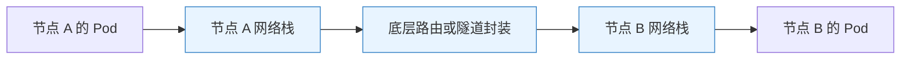

**读图**：图是跨节点路径概念，不规定某一插件必须使用桥接、隧道或特定内核钩子。hostNetwork 等配置还会改变地址与隔离行为。

### 10.2 Overlay 与直接路由的取舍

| 模型 | 主要收益 | 代价 |
|---|---|---|
| Overlay 封装 | 不必让底层逐一了解全部 Pod 路由，适配面广 | 额外包头、MTU 与可观测复杂度 |
| 直接路由 / 原生网络 | 减少封装，便于利用原生网络能力 | 需要底层路由、地址规划或云集成支持 |
| 云 VPC（Virtual Private Cloud，虚拟私有云）原生等方案 | 结合平台地址与安全能力 | 地址配额、成本与供应商约束 |

MTU（Maximum Transmission Unit，最大传输单元）不匹配可能出现小包可通、大请求卡住。是否发生 NAT（Network Address Translation，网络地址转换）要按路径判断，不能说集群内所有通信一律无任何地址转换。

### 10.3 NetworkPolicy 的组合逻辑

默认未被相应策略隔离时通常允许该方向流量；选中 Pod 的策略可分别限制 ingress/egress。策略在同方向通常是允许集合的并集，源侧出站和目标侧入站都需要允许才能连通；它不是按文件顺序“第一条匹配即结束”的防火墙列表。

创建对象不等于一定生效，网络实现需要支持；标准策略主要描述网络层/传输层范围，不自动提供完整应用身份、HTTP（Hypertext Transfer Protocol，超文本传输协议）路径授权或加密。默认拒绝出站时还要设计 DNS（Domain Name System，域名系统）等必要访问。

**排障抓手**：源 Pod → 解析 → 路由/封装 → 策略 → 目标监听；不要把“不同 Namespace”当作已隔离，也不要把“同 Namespace”当作一定可达。[NetworkPolicy 机制](https://kubernetes.io/docs/concepts/services-networking/network-policies/)

## 11. Service、EndpointSlice 与 DNS：稳定入口由哪些状态共同维持

> 🎯 **核心结论**：Service 提供稳定服务抽象，EndpointSlice 描述后端，数据面执行选择与转发；kube-proxy 通常维护规则而非亲自接收每个数据包。

### 11.1 从标签到请求

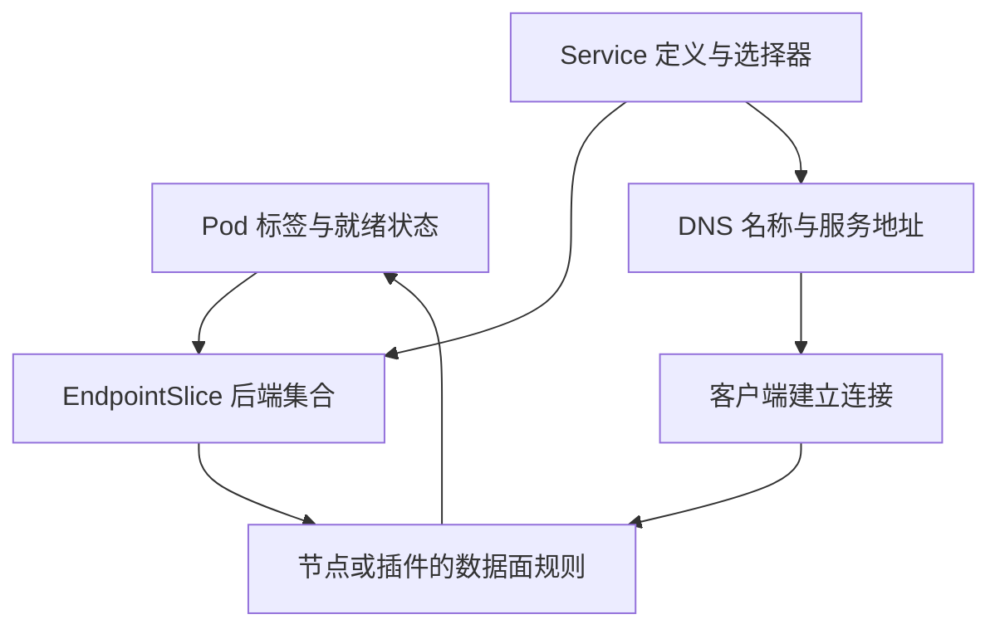

**读图**：Service 定义不监听应用端口，后端应用仍要在正确地址和 targetPort 上提供服务；API 中端点存在也不证明底层网络可达。

### 11.2 不同 Service 类型

| 形式 | 作用 | 容易误解 |
|---|---|---|
| ClusterIP | 集群内稳定虚拟入口 | 通常不是绑定给某个 Pod 的真实网卡地址 |
| NodePort | 经节点端口提供入口 | 默认端口范围可配置，节点地址、规则和防火墙仍相关 |
| LoadBalancer | 请求外部负载均衡集成 | 无云或合适实现时不会凭空出现外部地址 |
| Headless | 不分配常规 ClusterIP，提供后端发现等 | 不是“完全没有 Service 对象”，客户端需要处理实例 |
| ExternalName | DNS 别名映射 | 不是自动创建到外部地址的转发代理 |

没有 selector 的 Service 也可配人工/其他控制器维护的 EndpointSlice，不能绝对说每个 Service 都只对应当前集群内被标签选中的 Pod。

### 11.3 iptables、IPVS、nftables 与替代实现

iptables 通过内核规则处理，IPVS（IP Virtual Server，IP 虚拟服务器）使用相应内核负载均衡机制，nftables 使用更新的规则接口。它们在规则规模、更新和功能语义上有差异，不能用“IPVS 永远更先进”概括。

当前官方文档标记 IPVS 代理模式自 1.35 弃用；nftables 是需要相应内核与生态支持的演进方向，切换也有 NodePort 地址等差异。部分网络实现可使用 eBPF（extended Berkeley Packet Filter，扩展伯克利包过滤器）等机制实现 Service 数据面，不一定部署 kube-proxy。[虚拟 IP 与代理模式](https://kubernetes.io/docs/reference/networking/virtual-ips/)

### 11.4 为什么新 Pod 加入后已有连接没均分

常见 Service 选择发生在连接/流层面，连接跟踪、会话亲和与客户端连接池会保持既有路径；HTTP/2 等长连接还可能承载许多请求。因此副本数翻倍不代表所有请求立刻均分。

externalTrafficPolicy=Local 等策略会影响本地端点选择与源地址保留等行为，也可能让没有本地后端的入口节点无法正常转发。应与外部负载均衡健康检查和实现能力一起分析，而不是只改一个字段追求源 IP。

### 11.5 DNS 为什么可能查到地址却访问失败

解析只完成名称到记录转换，连接仍依赖规则、端口、策略和应用。Headless 与普通 Service 的记录语义不同，缓存和负缓存也影响状态变化可见时间。

EndpointSlice 把后端集合分片，减少大对象更新并支持现代能力；旧 Endpoints API 自 1.33 弃用。排障和扩展控制器应检查新端点资源，而非只读取旧对象。[Service 与 EndpointSlice](https://kubernetes.io/docs/concepts/services-networking/service/)

## 12. Ingress 与 Gateway API：入口规则和控制器不是一个东西

> 🎯 **核心结论**：Ingress/Gateway 是声明模型，控制器和数据面负责实现；创建路由对象不保证已经有入口能力。

### 12.1 从端口暴露到应用路由

Service 提供传输层入口等能力，HTTP（Hypertext Transfer Protocol，超文本传输协议）按域名、路径和证书处理需要更高层模型。Ingress 以常见 HTTP 路由为中心，复杂特性长期依赖控制器注解，导致可移植性和权限边界不清。

Gateway API 通过 GatewayClass、Gateway、HTTPRoute 等资源区分基础设施、入口和应用路由责任，并以能力与一致性测试促进实现协作。它通常通过 CRD（CustomResourceDefinition，自定义资源定义）安装，不是所有集群创建后自动具备的内置可用控制器。

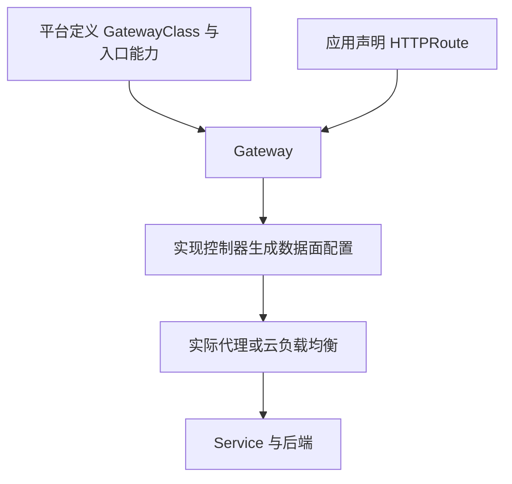

**读图**：资源权限和关联许可需要配合，跨 Namespace 引用也有边界；API 支持一种特性，不代表所有控制器版本都实现它。

### 12.2 比较的是模型与实现

| 选择 | 优势 | 边界 |
|---|---|---|
| Ingress | 常见路由模型成熟、存量多 | 扩展常依赖实现特有注解，API 功能趋于冻结 |
| Gateway API | 角色分工更明确、路由类型与扩展模型更丰富 | 需核对资源/API 版本和实现支持程度 |
| 直接应用网关 | 可表达业务聚合与定制 | 应用维护、容量与策略叠加成本 |

Kubernetes 入口与 Spring Cloud Gateway 可以承担不同层职责。重复的重试、限流和超时需要统一预算，不能每层都“加一点保险”。

### 12.3 社区 ingress-nginx 的历史边界

旧实验采用的社区 ingress-nginx 与 Ingress API 不是同一概念，也不等于所有名称含 NGINX 的控制器。官方公告说明其尽力维护截止 2026 年 3 月，随后不再发布修复；**既有部署继续运行不代表仍获得维护**。

重新学习时应理解存量行为，并评估受维护的实现或 Gateway API 路线；本次文档不把旧安装清单当作当前默认方案。[官方退役公告](https://kubernetes.io/blog/2025/11/11/ingress-nginx-retirement/)、[Gateway API 官方项目](https://gateway-api.sigs.k8s.io/)

## 13. 存储：Pod 短暂，数据怎样获得独立生命周期

> 🎯 **核心结论**：卷把存储与容器可写层分离，PV/PVC 协调供需，CSI 对接实际系统；这些对象不自动提供数据复制、备份或数据库一致性。

### 13.1 从可写层到存储抽象

| 形式 | 生命周期与位置 | 适合/限制 |
|---|---|---|
| 容器可写层 | 与具体容器实例关联 | 临时状态，重建不应依赖它 |
| emptyDir | 与 Pod 生命周期关联 | 同 Pod 容器共享；同 Pod 容器重启可保留，Pod 替换会丢失 |
| hostPath / 本地卷 | 依赖节点路径或本地介质 | 有节点亲和和安全/恢复边界，不能当跨节点共享盘 |
| 外部持久卷 | 由独立存储系统管理 | 可跨 Pod 生命周期，仍受后端可用性、拓扑和访问能力限制 |

### 13.2 PV、PVC、StorageClass、CSI

PV（PersistentVolume，持久卷）描述存储资源，PVC（PersistentVolumeClaim，持久卷声明）表达需求，StorageClass 描述动态供应等策略，CSI（Container Storage Interface，容器存储接口）连接编排与存储驱动。

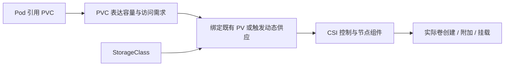

**读图**：PVC Bound 不是文件系统已挂载完成，更不证明数据库能正常读写。Pending、Attach、Mount 与应用权限是不同阶段。

### 13.3 为什么要延迟绑定

如果先把 PVC 绑定到某区域盘，再给 Pod 选节点，可能没有节点同时满足计算和存储区域。WaitForFirstConsumer 等机制让调度需求参与卷选择/供应，减少先后决策冲突；不是把 Pending 一律当存储系统故障。

### 13.4 访问模式的精确含义

| 模式 | 常见简写 | 关键边界 |
|---|---|---|
| ReadWriteOnce | RWO | 单节点读写，不等于单 Pod；同节点多个 Pod 可能共享 |
| ReadWriteMany | RWX | 多节点读写，仍需应用协调并发 |
| ReadOnlyMany | ROX | 多节点只读匹配语义，不应据此忽略实际挂载与后端写保护 |
| ReadWriteOncePod | RWOP | 对支持的 CSI 卷约束为单 Pod 使用，需匹配版本与组件 |

RWX 不提供数据库事务，RWO 也不是分布式业务锁。RWOP 自 1.29 稳定，存储驱动与相关组件仍需满足要求。[访问模式说明](https://kubernetes.io/docs/concepts/storage/persistent-volumes/)

### 13.5 删除、扩容、快照与恢复

删除 Pod、PVC、PV 与后端数据是不同动作，Retain/Delete 回收策略和控制器保留设置共同决定结果。动态供应卷常见 Delete 策略，但必须检查实际对象，不能靠印象。

卷扩容依赖驱动、StorageClass 和文件系统支持，不能默认支持任意缩容。存储快照可能只具备崩溃一致性，应用一致快照需要数据库配合；备份还要验证离线/跨故障域保存和恢复时间。

**故障边界**：节点失联后将同一盘交给新实例前，可能需要隔离旧写者。删除 Kubernetes 对象不等于旧节点进程被可靠停止，有状态系统需要 fencing（隔离旧写者）等能力。

## 14. ConfigMap、Secret 与配置生效：更新对象之后发生什么

> 🎯 **核心结论**：配置对象、容器可见内容和应用实际采用值是三个层次；热更新需要应用与平台共同支持。

### 14.1 三种消费方式

| 方式 | 更新特征 | 代价 |
|---|---|---|
| 环境变量 | 创建容器时注入，运行中通常不随对象修改而更新 | 简单但常需重建工作负载使新值生效 |
| 普通投射卷 | 内容通常最终更新，存在传播延迟 | 应用要重读，已打开文件和监视方式需正确处理 |
| subPath 挂载 | 不获得同样的自动更新行为 | 不能按普通卷推断热更新 |

ConfigMap 保存的是配置数据，不是把 Redis 的业务数据库“存进 etcd”。即使文件已经变了，应用仍可能继续使用内存旧配置；需监听、重载或滚动更新。[ConfigMap 更新边界](https://kubernetes.io/docs/concepts/configuration/configmap/)

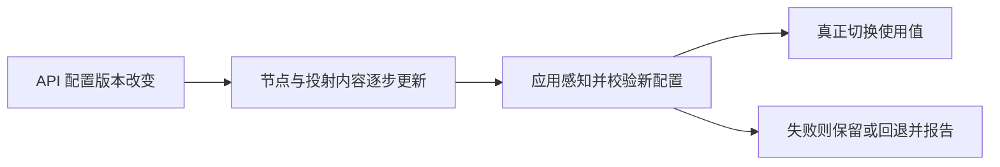

**读图**：集群中不同实例可能短期使用不同版本。文件同步不构成全局原子发布，关联参数宜整体校验并保留版本。

### 14.2 Secret 为什么不是“天然加密保险箱”

Secret 把敏感数据与普通配置在 API 和使用方式上区分；Base64 是编码，不能当加密。默认持久化是否加密要看集群配置，官方文档说明默认未加密存于底层存储，应检查静态加密、访问权限与审计。

有权在 Namespace 创建 Pod 的主体，可能借挂载读取该范围内 Secret，因此不能只看是否授予 get secrets。镜像、日志、环境变量展示与错误页也会形成其他暴露路径。[Secret 官方说明](https://kubernetes.io/docs/concepts/configuration/secret/)

### 14.3 如何选择配置发布策略

低风险阈值可热更新；数据源、协议开关、密钥轮转与相关多参数需要校验、灰度和回退。不可变配置对象加版本化引用，或修改 Pod 模板触发受控滚动，可以提升可追踪性，代价是需要重新启动和容量窗口。

**不要把“无需重建镜像”混同“无需重启进程”**，也不要把进程成功读取新文件混同业务已安全切换。

## 15. 认证、RBAC、准入与运行隔离：不同层保护不同对象

> 🎯 **核心结论**：认证确认调用身份，授权决定 API 操作，准入约束对象内容，运行隔离限制进程能力；任何单层都不能包办安全。

### 15.1 API 请求的安全链

**读图**：图按职责简化，实际链路还包含解码、默认化等处理。通过 API 授权不保证对象满足准入规则，创建成功也不保证运行时无法越权。

RBAC（Role-Based Access Control，基于角色的访问控制）用角色定义资源、动词与范围，再通过绑定授予主体。Role/RoleBinding 主要面向 Namespace 范围；ClusterRole 可描述集群级或可复用规则，绑定方式决定授予范围，不能简单说 ClusterRole 一定在任何绑定下都是全局授权。

### 15.2 ServiceAccount 与权限间接提升

ServiceAccount 为工作负载提供身份，不等于业务用户账号。现代投射令牌支持有效期、受众和轮换等机制，不应把旧的长期静态 token 示例当默认模型；不需要访问 API 的工作负载可减少令牌挂载。

有权创建高权限 Pod、绑定权限或使用某服务账号，可能间接获得更大能力。权限评估不仅看 get/list，还要看创建工作负载、exec、读取 Secret 和可用账号。[RBAC 官方实践](https://kubernetes.io/docs/concepts/security/rbac-good-practices/)

### 15.3 准入为何既强大又可能影响可用性

Mutating/Validating Webhook 可注入配置或拒绝危险对象，但依赖远程服务。Webhook 超时、证书或网络故障可能阻塞大量创建和更新；失败策略、匹配范围、延迟和高可用都要设计。

适合表达式验证的规则，可比较内置 ValidatingAdmissionPolicy 与外部 Webhook。前者使用 CEL（Common Expression Language，通用表达式语言），减少部分远程依赖，但不能直接替代所有外部业务逻辑；该能力自 1.30 稳定。[官方策略说明](https://kubernetes.io/docs/reference/access-authn-authz/validating-admission-policy/)

### 15.4 Namespace、配额和沙箱的不同边界

Namespace 提供命名与部分策略范围，ResourceQuota 控制总体资源额度，LimitRange 约束默认值/范围等；它们不自动提供强多租户内核隔离。运行时还涉及非 root、能力裁剪、seccomp、文件系统、宿主挂载与网络权限。

PSA（Pod Security Admission，Pod 安全准入）可实施相应 PSS（Pod Security Standards，Pod 安全标准）；旧 PSP（PodSecurityPolicy，Pod 安全策略）已在 1.25 移除。集群级策略与应用自身授权仍要配合，不能把容器里运行非 root 当作所有安全问题已解决。

## 16. HPA、VPA 与节点伸缩：扩的是哪一层能力

> 🎯 **核心结论**：HPA 调副本，VPA 调资源建议/配置，节点伸缩提供可放置容量；三者有不同观察周期与瓶颈。

### 16.1 HPA 的基本比例

HPA（Horizontal Pod Autoscaler，水平 Pod 自动伸缩器）周期读取指标并调整目标副本。最简模型为：

`期望副本 = ceil（当前副本 × 当前指标 / 目标指标）`

例如 4 副本当前平均 CPU 利用率 80%，目标 50%，简化建议为 `ceil(4 × 80 / 50) = 7`。这里 CPU 利用率目标通常相对 requests，不是 limits。实际还有容差、缺失样本、未就绪实例、稳定窗口和速率策略。

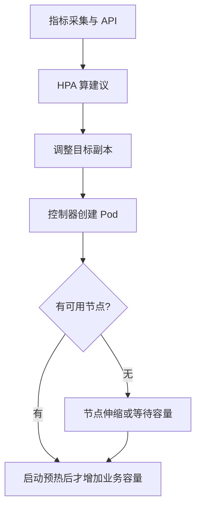

**读图**：伸缩存在采集、判断、调度、拉镜像和预热延迟，不能在突发瞬间凭空提供完整能力。

### 16.2 指标不是随便选一个数字

CPU 请求未正确设置时，利用率计算会受到影响；Metrics Server 负责常见资源指标，不等于完整长期监控平台。队列积压、并发和请求率可能更贴业务，但要有对应指标适配与明确的容量关系。

多个指标时通常取所建议副本中的较大值；部分指标错误可能阻止缩容等行为，不能只看某一个 CPU 值。扩副本还可能把数据库连接数同步放大，瓶颈在数据库时越扩越糟。[HPA 算法说明](https://kubernetes.io/docs/concepts/workloads/autoscaling/horizontal-pod-autoscale/)

### 16.3 VPA 与节点扩缩

VPA（Vertical Pod Autoscaler，垂直 Pod 自动伸缩器）通过相关组件分析/调整资源需求，通常需要另行部署；是否重建或原地调整取决于版本、更新模式与支持。节点自动伸缩依据不可调度需求等提供/回收计算节点，也需云或基础设施集成。

VPA 改 requests 会改变基于 request 的 CPU 利用率分母，可能与同指标 HPA 互相影响。分离控制维度、合理配置模式与观察周期，比同时打开所有自动化更可靠。

### 16.4 原地资源调整的意义与限制

容器 CPU/内存原地调整在 1.35 稳定，降低部分重建成本，但需要节点容量、运行时与应用适配；可能待定、无法实施或按策略重启容器，不是“无条件不停机随意改任何字段”。

资源变了，应用也未必动态调整线程池、堆或内部缓存。该能力和 VPA 是不同层次，应分别验证。[原地调整官方说明](https://kubernetes.io/docs/tasks/configure-pod-container/resize-container-resources/)

## 17. 高可用与灾难恢复：控制面、应用和数据要分别设计

> 🎯 **核心结论**：多副本只能解决特定故障范围；真正可用性取决于故障域分布、依赖、恢复能力与业务协议。

### 17.1 三层可用性

| 层次 | 需要保护 | 常见缺口 |
|---|---|---|
| 控制面 | API 入口、etcd 多数派、控制器与调度器协调 | API 多副本但共享单点负载均衡/存储 |
| 应用数据面 | 多实例、入口、网络与依赖 | 所有副本落同一节点或同一故障区域 |
| 持久数据与业务 | 数据库复制、备份、选主与幂等 | Pod 能补建但卷、密钥或业务状态无法恢复 |

跨可用区不是把副本数改成 3；还需节点标签与分布约束、存储拓扑、外部负载均衡和依赖的区域能力。严格分布可能牺牲故障时调度可用性，软分布又可能集中实例，需明确取舍。

### 17.2 网络分区为什么比进程退出更难

控制面看不到旧节点，不证明旧进程已经停止。无状态请求可依赖路由和幂等降低影响；数据库旧主仍写、同时新主启动，则需要存储/数据库侧隔离旧写者。

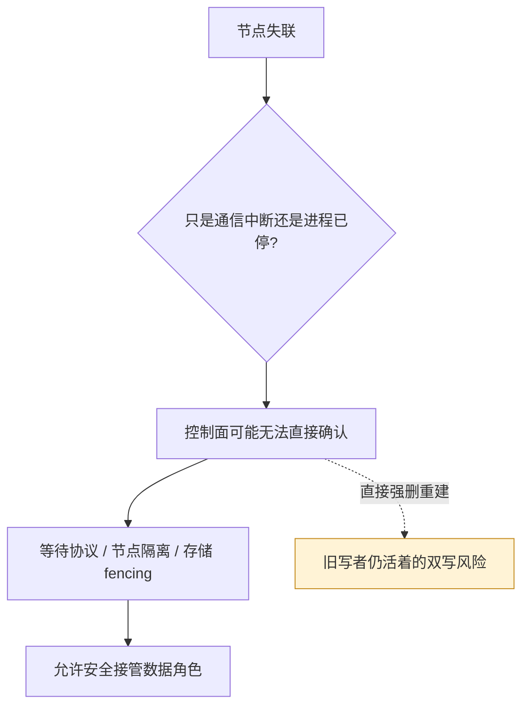

**读图**：Kubernetes 对象唯一不自动证明外部世界只有一个写者；强删对象主要改变控制面记录，不是可靠电源切断。

### 17.3 备份应包含什么

etcd 快照保存控制状态，应用数据库/PV 数据、加密密钥、证书、镜像来源和外部资源还需单独规划。仅备份 YAML 不能重建当前数据库内容；只备份磁盘也可能丢失解密能力与业务一致性。

RPO（Recovery Point Objective，恢复点目标）描述可容忍的数据回退范围，RTO（Recovery Time Objective，恢复时间目标）描述恢复用时目标。应通过恢复演练验证，而不是由“有三副本”和“每天有备份”直接推导。

### 17.4 自愈边界

平台可以重启崩溃进程或创建新实例，但错误配置会被一遍遍正确地执行，数据损坏也可能被复制放大。恢复机制必须能区分暂时故障、错误发布与永久数据问题，必要时停止自动扩散。

## 18. CRD、Operator、Helm 与 GitOps：哪些是定义，哪些是持续执行

> 🎯 **核心结论**：CRD 扩展对象模型，控制器赋予行为，Operator 编码领域运维知识；模板与 Git 驱动交付处理的是另一层职责。

### 18.1 为什么只有 CRD 不会自动管理数据库

CRD（CustomResourceDefinition，自定义资源定义）让 API 能校验、保存并提供特定结构对象。真正创建、升级、备份数据库，需要控制器观察并执行；Operator 通常把这种领域控制器与资源模型组合起来。

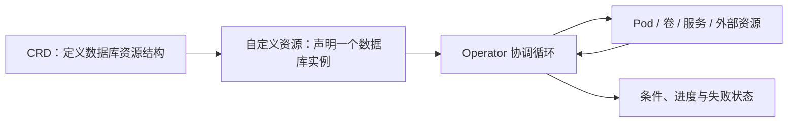

**读图**：一个优秀 Operator 还要处理幂等、版本升级、部分成功、最终清理与灾难恢复，不是生成几份 StatefulSet 清单就完成。[Operator 官方说明](https://kubernetes.io/docs/concepts/extend-kubernetes/operator/)

### 18.2 模板、发布与漂移协调

Helm 常用于参数化打包资源与组织发布记录；GitOps 是围绕版本化期望状态、自动协调与审查的交付方式，具体由相关控制器实现。YAML（YAML Ain't Markup Language，一种数据序列化语言）仅是常见声明格式，不是控制逻辑本身。

离线渲染清单、向集群应用、持续监控并纠正漂移，属于不同动作。已有 GitOps 管理 replicas，而 HPA 也控制 replicas，若未明确字段归属就可能反复覆盖；应按字段划分管理责任，结合服务端字段管理等机制。[Helm Chart 模型](https://helm.sh/docs/topics/charts/)、[OpenGitOps 原则](https://opengitops.dev/)

### 18.3 不宜把 Kubernetes API 当所有业务数据库

自定义对象适合平台期望与状态，不宜未经评估承载高频订单流水、海量短期事件或大二进制载荷。对象数量、Watch、API 限流和 etcd 写入放大会影响整个控制面。

**设计取舍**：用声明接口统一平台能力很强，但状态粒度、控制器可靠性与 API 成本需要预算；控制循环并不提供跨外部系统的自动事务。

## 19. 观测与排障：从用户症状向资源因果链回溯

> 🎯 **核心结论**：对象状态是证据的一部分，必须与事件、日志、指标、链路和真实数据路径联合判断。

### 19.1 分层定位表

| 症状 | 先查 | 再查 |
|---|---|---|
| Pending | 是否已调度、FailedScheduling 事件 | requests、污点、亲和、卷、区域与配额 |
| ContainerCreating | sandbox、网络与卷事件 | CNI、CSI、权限和节点状态 |
| ImagePullBackOff | 镜像名/摘要、凭据、拉取事件 | 网络、仓库限制、架构、证书 |
| CrashLoopBackOff | 退出原因与前一次容器日志 | 配置、启动依赖、探针、OOM 与退避 |
| Running 但不接流量 | Ready、选择器、EndpointSlice | 端口、策略、监听地址和入口健康 |
| Service 不通 | DNS 与服务地址是否正常 | 后端直连、数据面规则、策略与连接跟踪 |
| PVC Pending / 挂载失败 | 供应、绑定、附加、挂载所处阶段 | 存储类、驱动、拓扑、权限与卷占用 |
| 发布卡住 | 新旧 ReplicaSet 与可用状态 | 资源余量、探针、进度、PDB/drain 的实际路径 |
| 延迟抖动 | P95/P99、排队和错误 | CPU 节流、GC、下游、网络与伸缩滞后 |

P95/P99（95th/99th Percentile，第 95/99 百分位）反映尾延迟，不能只看平均 CPU 就判断容量充足。GC（Garbage Collection，垃圾回收）等应用内部工作也可能与容器配额交互。

### 19.2 最少量命令对应的证据

| 观察 | 证据用途 | 限制 |
|---|---|---|
| `kubectl get ... -o yaml` | 对象实际 spec/status、版本与管理信息 | 不是应用业务真相的完整记录 |
| `kubectl describe pod ...` | 条件、事件与节点信息 | 事件可能聚合、过期，不是永久审计账本 |
| `kubectl logs ... --previous` | 上一次容器实例退出前日志 | Pod 已替换或节点日志丢失时可能不可用 |
| `kubectl top ...` | 当前资源指标线索 | 不等于长期峰值、节流和全部内存证据 |

排查顺序应先观察再改变状态，避免重启清掉现场。集中日志和指标可保留跨 Pod 生命周期证据，追踪用于关联请求路径；业务成功仍需要应用指标和权威记录。

### 19.3 一次 503 的端到端推演

**读图**：同一状态码可能由入口无后端、策略拒绝、应用主动返回或下游失败映射产生，应先确定是谁返回的，再验证下一层。

### 19.4 有价值的故障演练

除了删 Pod，还要模拟节点失联、网络延迟、存储不可用、控制面只读/不可写、坏配置和下游慢响应。观察恢复时间、重复任务、在途请求、数据状态与副本分布，而不只看最终 Pod 变绿。

## 20. 版本演进与旧材料迁移：能力、默认值和实现要分别核对

> 🎯 **核心结论**：Kubernetes 次版本迭代频繁，旧对象可能还能识别，但运行时、插件和维护状态已变化；“学到一个版本”不等于所有功能默认可用。

### 20.1 关键节点如何影响知识模型

| 节点 | 代表变化 | 应修正的旧理解 |
|---|---|---|
| 1.20 时代 | 本项目旧实验的主要环境 | Docker 运行时与旧安装源属于当时组合 |
| 1.24 | 移除内置 dockershim | 镜像兼容和节点运行时接入分开判断 |
| 1.25 | 移除 PSP 等旧 API | 安全准入不能照搬旧策略对象 |
| 1.29 | RWOP 达到稳定 | 单节点挂载与单 Pod 使用有不同能力 |
| 1.30 | ValidatingAdmissionPolicy 稳定 | 部分准入规则可在进程内用 CEL 校验 |
| 1.33 | 原生 Sidecar 稳定；旧 Endpoints API 弃用 | 生命周期与后端发现采用现代模型 |
| 1.35 | 容器原地 CPU/内存调整稳定；IPVS 代理模式弃用 | 资源变更与 Service 数据面都有演进 |
| 当前版本线 | 官方发布页列 1.37、1.36、1.35 为维护分支 | 这是查阅时状态，不应永远写死为“主流版本” |

以上只选影响原理理解的节点，并非完整发布清单。[官方发布页](https://kubernetes.io/releases/)、[dockershim 说明](https://kubernetes.io/blog/2022/02/17/dockershim-faq/)、[1.25 移除说明](https://kubernetes.io/blog/2022/08/04/upcoming-changes-in-kubernetes-1-25/)

### 20.2 Alpha、Beta、Stable 不能省略

功能门控、API 版本和插件支持共同决定能否使用。核心能力稳定，不代表它的所有后续扩展都稳定；某字段出现在最新文档，也不代表旧 kubelet 已理解。DRA（Dynamic Resource Allocation，动态资源分配）等设备能力还需要对应驱动与资源模型，不能仅添加字段便获得硬件能力。

容器原地资源调整和传统重建式调整、原生 Sidecar 和普通伴生容器，都应按版本说明。供应商发行版可能有额外限制或提前回移植，应以其兼容与支持说明补充判断。

### 20.3 组件版本偏差与升级次序

当前官方策略中，HA（High Availability，高可用）API Server 实例之间最多相差一个次版本；kubelet 不能比其连接的 API Server 更新，允许落后的范围还看版本政策；kubectl 一般支持与 API Server 相差一个次版本。混合 API Server 时取共同允许范围。

升级通常先控制面再节点，逐阶段验证；工具、运行时、CNI、CSI、Webhook 和 API 移除还会施加额外约束。**允许运行偏差不是鼓励跳过多个版本升级，也不是承诺所有第三方插件兼容**。[官方版本偏差策略](https://kubernetes.io/releases/version-skew-policy/)

### 20.4 旧笔记怎样继续使用

| 旧内容 | 新的阅读位置 | 需要补足 |
|---|---|---|
| 基础概念与组件图 | 第 1—3 章 | 声明、控制循环与故障边界 |
| Pod / Deployment 实验 | 第 4—9 章 | 探针、停止、PDB、调度与资源 |
| Service / Ingress | 第 10—12 章 | EndpointSlice、数据面、Gateway 与实现维护状态 |
| PV/PVC / ConfigMap / Secret | 第 13—15 章 | 拓扑、访问模式、实际生效和权限 |
| 自动修复与扩缩容描述 | 第 16—19 章 | 指标、故障域、恢复和可观测证据 |

旧安装中的固定镜像、外部链接、Dashboard 权限和网络假设不作为当前推荐配置。保留实验帮助理解操作结果，新主线用于解释为什么与何时失效。

## 参考资料

| 主题 | 官方资料 |
|---|---|
| 架构与控制 | [组件](https://kubernetes.io/docs/concepts/overview/components/)、[控制器](https://kubernetes.io/docs/concepts/architecture/controller/)、[API 概念](https://kubernetes.io/docs/reference/using-api/api-concepts/) |
| Pod 与应用 | [生命周期](https://kubernetes.io/docs/concepts/workloads/pods/pod-lifecycle/)、[Sidecar](https://kubernetes.io/docs/concepts/workloads/pods/sidecar-containers/)、[StatefulSet](https://kubernetes.io/docs/concepts/workloads/controllers/statefulset/)、[CronJob](https://kubernetes.io/docs/concepts/workloads/controllers/cron-jobs/) |
| 调度与资源 | [调度器](https://kubernetes.io/docs/concepts/scheduling-eviction/kube-scheduler/)、[资源管理](https://kubernetes.io/docs/concepts/configuration/manage-resources-containers/)、[压力驱逐](https://kubernetes.io/docs/concepts/scheduling-eviction/node-pressure-eviction/)、[PDB 与中断](https://kubernetes.io/docs/concepts/workloads/pods/disruptions/) |
| 网络 | [Service](https://kubernetes.io/docs/concepts/services-networking/service/)、[虚拟 IP](https://kubernetes.io/docs/reference/networking/virtual-ips/)、[NetworkPolicy](https://kubernetes.io/docs/concepts/services-networking/network-policies/)、[Gateway](https://kubernetes.io/docs/concepts/services-networking/gateway/) |
| 网络实现示例 | [Cilium 的 kube-proxy 替代机制](https://docs.cilium.io/en/stable/network/kubernetes/kubeproxy-free/)：用于区分平台模型与某个实现 |
| 存储与配置 | [PV](https://kubernetes.io/docs/concepts/storage/persistent-volumes/)、[StorageClass](https://kubernetes.io/docs/concepts/storage/storage-classes/)、[ConfigMap](https://kubernetes.io/docs/concepts/configuration/configmap/)、[Secret](https://kubernetes.io/docs/concepts/configuration/secret/) |
| 权限与扩展 | [RBAC](https://kubernetes.io/docs/concepts/security/rbac-good-practices/)、[准入策略](https://kubernetes.io/docs/reference/access-authn-authz/validating-admission-policy/)、[Operator](https://kubernetes.io/docs/concepts/extend-kubernetes/operator/) |
| 伸缩与演进 | [HPA](https://kubernetes.io/docs/concepts/workloads/autoscaling/horizontal-pod-autoscale/)、[原地资源调整](https://kubernetes.io/docs/tasks/configure-pod-container/resize-container-resources/)、[DRA](https://kubernetes.io/docs/concepts/resource-management/dynamic-resource-allocation/)、[发布状态](https://kubernetes.io/releases/)、[版本偏差](https://kubernetes.io/releases/version-skew-policy/) |

官方页面会持续更新。解释历史项目应同时查看对应版本文档、功能门控、发行版与插件支持，不把当前文档默认值直接外推到旧集群。

## 附录：术语与缩写

| 术语 | 英文全称 | 中文含义 / 边界 |
|---|---|---|
| K8s | Kubernetes，首尾字母间省略 8 个字母 | Kubernetes 的常见简称 |
| API | Application Programming Interface | 应用程序编程接口 |
| YAML | YAML Ain't Markup Language | 数据序列化语言，常用于资源声明 |
| UID | Unique Identifier | 区分对象实例的唯一标识符 |
| SSA | Server-Side Apply | 服务端应用，管理字段归属与冲突 |
| CRI | Container Runtime Interface | 容器运行时接口 |
| OCI | Open Container Initiative | 开放容器倡议，定义镜像/运行等标准 |
| CNI | Container Network Interface | 容器网络接口 |
| CSI | Container Storage Interface | 容器存储接口 |
| CPU | Central Processing Unit | 中央处理器 |
| GPU | Graphics Processing Unit | 图形处理器 |
| OOM | Out of Memory | 内存不足 |
| QoS | Quality of Service | 服务质量类别 |
| PID | Process Identifier | 进程标识符 |
| PDB | Pod Disruption Budget | Pod 中断预算 |
| DNS | Domain Name System | 域名系统 |
| IP | Internet Protocol | 网际协议，文中常指网络地址 |
| NAT | Network Address Translation | 网络地址转换 |
| MTU | Maximum Transmission Unit | 最大传输单元 |
| VPC | Virtual Private Cloud | 虚拟私有云 |
| HTTP | Hypertext Transfer Protocol | 超文本传输协议 |
| IPVS | IP Virtual Server | Linux IP 虚拟服务器机制 |
| eBPF | extended Berkeley Packet Filter | 扩展伯克利包过滤器 |
| PV | PersistentVolume | 持久卷资源 |
| PVC | PersistentVolumeClaim | 持久卷声明 |
| RWO | ReadWriteOnce | 单节点读写访问模式 |
| RWX | ReadWriteMany | 多节点读写访问模式 |
| ROX | ReadOnlyMany | 多节点只读访问模式 |
| RWOP | ReadWriteOncePod | 支持条件下的单 Pod 使用模式 |
| RBAC | Role-Based Access Control | 基于角色的访问控制 |
| CEL | Common Expression Language | 通用表达式语言 |
| PSP | PodSecurityPolicy | 已移除的 Pod 安全策略机制 |
| PSA | Pod Security Admission | Pod 安全准入 |
| PSS | Pod Security Standards | Pod 安全标准 |
| HPA | Horizontal Pod Autoscaler | 水平 Pod 自动伸缩器 |
| VPA | Vertical Pod Autoscaler | 垂直 Pod 自动伸缩器 |
| DRA | Dynamic Resource Allocation | 动态资源分配 |
| HA | High Availability | 高可用 |
| RPO | Recovery Point Objective | 恢复点目标 |
| RTO | Recovery Time Objective | 恢复时间目标 |
| CRD | CustomResourceDefinition | 自定义资源定义 |
| GC | Garbage Collection | 垃圾回收；本文需区分应用 GC 与资源回收 |
| P95/P99 | 95th/99th Percentile | 第 95/99 百分位 |
| Reconcile | Reconciliation Loop | 协调循环，观察并补足期望差异 |
| Quorum | Quorum | 法定多数 |
| Finalizer | Finalizer | 最终删除前的清理协调标记 |
| Fencing | Fencing | 隔离旧写者，防止故障接管后的并发写入 |
